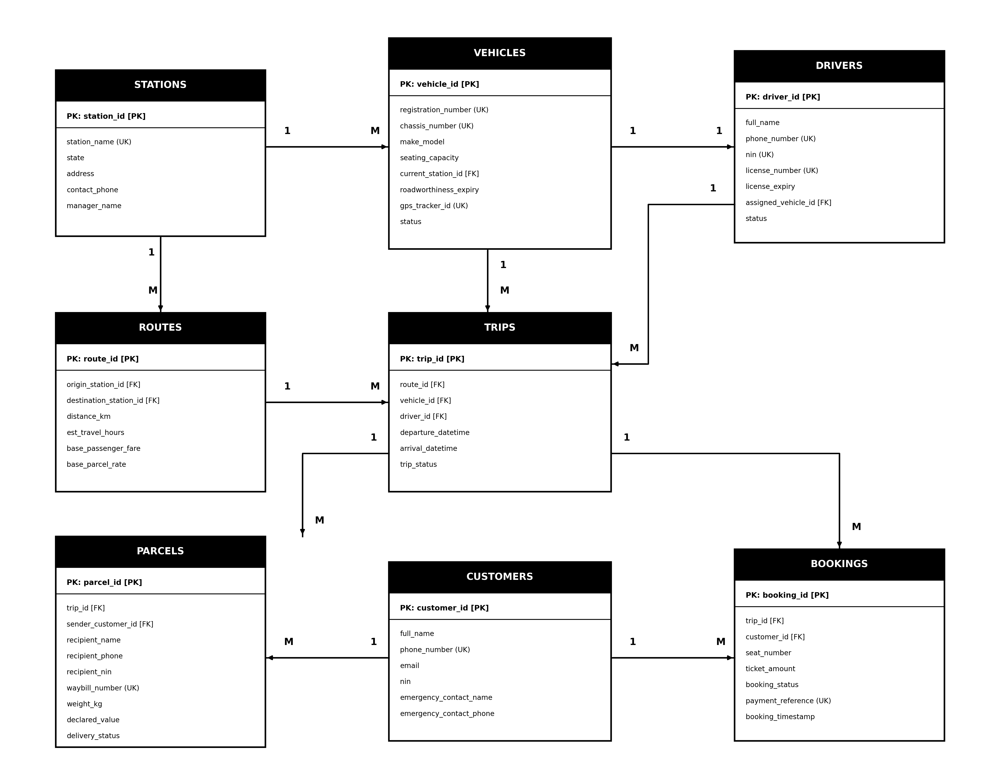

# Portfolio 1: Database Design and Modelling

**Student Name:** Adedoyin Ajeyomi  
**Student ID:** 20260520  
**Course:** Advanced Database Systems  
**Case Study:** Adedoyin Mobility and Logistics  

---

## 1. Case Study: Adedoyin Mobility and Logistics

### 1.1 About the Company
Adedoyin Mobility and Logistics is a Nigerian transport company. The company helps people travel between different states and also helps them send parcels. 

The company has:
- **20 vehicles:** A mix of Toyota HiAce buses (14 to 18 seats) and Toyota Sienna minivans (7 to 8 seats).
- **6 regional stations:** 
  1. Lagos (Ojota Terminal)
  2. Ibadan (Iwo Road Terminal)
  3. Abuja (Utako Terminal)
  4. Benin City (Ramat Park Terminal)
  5. Enugu (Holy Ghost Terminal)
  6. Kano (Sabon Gari Terminal)

The vehicles travel along major highways in Nigeria, such as Lagos to Ibadan, Lagos to Benin, Abuja to Kano, and Lagos to Abuja.

### 1.2 What the System Does
The system handles two main jobs:
1. **Passenger Trips:** Customers can check available trips, pick their travel date, choose an empty seat, and pay for their ticket.
2. **Parcel Delivery:** Customers can drop off packages at any station to be delivered to another station on the same route. Each package gets a tracking code so the customer can check its status.

### 1.3 KYC and Dashboard Needs
The company uses a management dashboard to run daily work. Because of safety and government rules (like the Federal Road Safety Corps / FRSC), the database must store identity details (KYC):
- **Drivers:** Full name, phone number, National Identity Number (NIN), driver's license number, and license expiry date.
- **Customers:** Full name, phone number, NIN, and an emergency contact (next-of-kin name and phone).
- **Vehicles:** Plate number, chassis number (VIN), GPS tracker code, and roadworthiness expiry date.
- **Parcels:** Sender details, recipient name, phone number, and recipient NIN to make sure the right person picks up the package.

---

## 2. Entity Relationship Diagram (ERD)

To keep the database clean and easy to understand without making it overly complicated, we designed **8 tables**.

### 2.1 Entity Relationship Diagram

### 2.2 Table Relationships
The diagram above shows how the 8 tables connect:
- **Stations to Routes (1 to Many):** One station can be the starting point or ending point for many routes.
- **Stations to Vehicles (1 to Many):** Each vehicle is based at one station.
- **Vehicles to Drivers (1 to 1):** Each vehicle is assigned to a primary driver.
- **Routes to Trips (1 to Many):** One route (like Lagos to Abuja) has many scheduled trips.
- **Vehicles to Trips (1 to Many):** One vehicle is used for many trips over time.
- **Drivers to Trips (1 to Many):** One driver drives many trips over time.
- **Trips to Bookings (1 to Many):** One trip has many passenger seats booked.
- **Customers to Bookings (1 to Many):** One customer can book seats on different trips.
- **Trips to Parcels (1 to Many):** One trip carries many customer packages.
- **Customers to Parcels (1 to Many):** One customer can send multiple parcels.

---

## 3. The 8 Tables Explained

| Table Name | Primary Key | What it Stores |
| :--- | :--- | :--- |
| **`stations`** | `station_id` | Information about the 6 stations (name, city, state, address, phone number). |
| **`vehicles`** | `vehicle_id` | Details of the 20 vehicles (plate number, chassis number, model, number of seats, GPS code). |
| **`drivers`** | `driver_id` | Driver details, NIN, license number, license expiry date, and status. |
| **`customers`** | `customer_id` | Customer details, phone number, NIN, and emergency contact for safety. |
| **`routes`** | `route_id` | Start station, end station, distance in kilometers, normal travel time, and base price. |
| **`trips`** | `trip_id` | A scheduled journey linking a route, a vehicle, and a driver with travel times and status. |
| **`bookings`** | `booking_id` | A seat bought by a customer on a trip, ticket price, and payment reference. |
| **`parcels`** | `parcel_id` | A package sent on a trip, weight, sender, recipient details, and tracking status. |

---

## 4. Keys and Rules (Constraints)

### 4.1 Keys
- **Primary Key (PK):** A unique number that identifies each row (like `customer_id` or `trip_id`). No two rows can have the same primary key.
- **Foreign Key (FK):** A field that links one table to another (for example, `bookings.customer_id` links back to `customers.customer_id`).
- **Unique Keys:** Fields that cannot be repeated, such as plate numbers, NINs, driver license numbers, and parcel waybill codes.

### 4.2 Business Rules Built into the Database
1. **No Double Booking:** A seat cannot be sold twice on the same trip. We put a unique rule on `(trip_id, seat_number)`.
2. **Vehicle Capacity:** Buses and minivans have between 7 and 18 seats. We check that `seating_capacity BETWEEN 7 AND 18`.
3. **Valid Routes:** A route cannot start and end at the same station (`origin_station_id <> destination_station_id`).
4. **Sensible Times:** A trip cannot arrive before it leaves (`arrival_datetime > departure_datetime`).
5. **Positive Numbers:** Prices, distances, and parcel weights must be greater than zero.
6. **NIN Format:** National Identity Numbers must have exactly 11 digits.

---

## 5. Normalisation (Step-by-Step)

Normalisation is the process of organising data so we don't repeat information or create mistakes when adding, updating, or deleting records.

### 5.1 Unnormalised Form (UNF)
If we tried to put all data into one giant table:
- Every time a trip is scheduled, we would have to type the driver's name, phone, license, vehicle details, passenger details, and parcel details all in one row.
- **The Problem:** If 14 passengers take the same bus, the driver's name and vehicle plate number are typed 14 times. If a trip is cancelled, deleting the row might accidentally delete customer information.

### 5.2 First Normal Form (1NF)
**Rule:** Each cell must hold only one single value, and there must be no repeating groups.
- In UNF, multiple passengers were listed together in one trip row.
- **Fix:** We separate passengers and parcels into their own rows so every entry has a single, atomic value.

### 5.3 Second Normal Form (2NF)
**Rule:** Must be in 1NF, and all non-key fields must depend on the whole primary key, not just part of it.
- In our bookings table, the full key could be `(trip_id, seat_number)`.
- If we stored the customer's full address or phone number in the booking row, that depends only on who the customer is, not on the trip or the seat number.
- **Fix:** We moved customer details into a separate `customers` table and route details into a `routes` table.

### 5.4 Third Normal Form (3NF)
**Rule:** Must be in 2NF, and no field should depend on another field that is not a primary key.
- For example, in the trips table, if we stored the driver's phone number or license number, those belong to the driver, not directly to the trip. The trip only needs to know the `driver_id`.
- **Fix:** We created separate tables for `drivers`, `vehicles`, and `stations`. The `trips` table now only holds foreign keys (`driver_id`, `vehicle_id`, `route_id`).

### 5.5 Boyce-Codd Normal Form (BCNF)
**Rule:** Every determinant (the field that decides other fields) must be a candidate key.
- In our 8 tables:
  - Route prices and distances are determined by the origin and destination pair.
  - Parcel details are determined by the unique waybill number.
  - Seat allocations are determined by the combination of trip and seat number.
- All our tables meet BCNF. This means there is no wasted space, no duplicate typing, and updates can be made safely in one place.

---

## 6. How to Run in pgAdmin 4 (Step-by-Step)

You do not need to use the command line terminal. You can run all scripts directly using **pgAdmin 4**:

1. **Create the Database:**
   - In pgAdmin 4, right-click **Databases** > **Create** > **Database...**
   - Name it `adedoyin_mobility` and click **Save**.

2. **Run the Schema DDL Script:**
   - Click to highlight `adedoyin_mobility`.
   - Open Query Tool (`Tools` > `Query Tool`).
   - Click **Open File** (`Ctrl + O`), choose `portfolio-1-database-design/Ajeyomi_Adedoyin_20260520_Schema.sql`, and press **F5** (Execute).
   - This builds all 8 tables, foreign keys, and constraints.

3. **Populate Seed Records:**
   - Click **Open File** (`Ctrl + O`), choose `portfolio-1-database-design/Ajeyomi_Adedoyin_20260520_Seed_Data.sql`, and press **F5** (Execute).
   - This populates all stations, vehicles, drivers, trips, bookings, and parcels.

---

## 7. Visual Verification Evidence (Screenshots in `assets/`)

| Deliverable | Visual Evidence / Screenshot |
| :--- | :--- |
| **Entity Relationship Diagram (ERD)** |  |
| **pgAdmin 4 Schema Tables View** |  |
| **pgAdmin 4 Seed Data Verification** |  |
