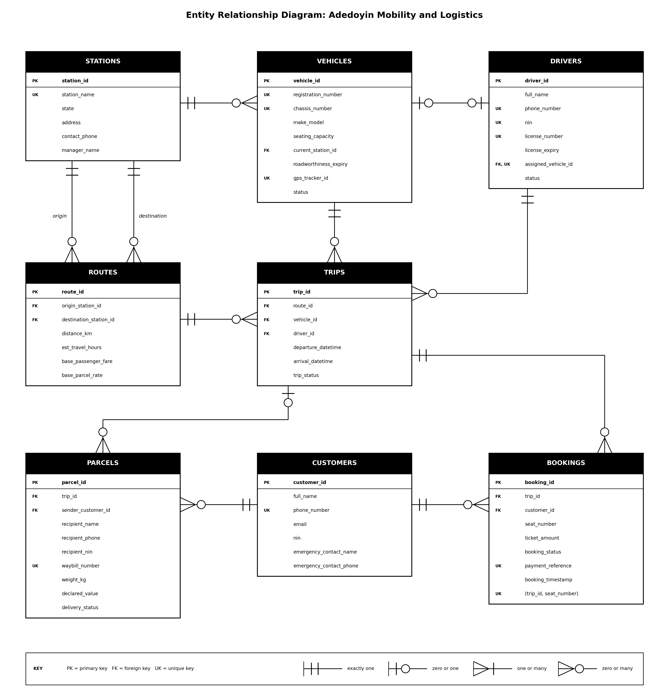

# Portfolio 1: Database Design and Modelling

**Student Name:** Adedoyin Ajeyomi  
**Student ID:** 20260520  
**Course:** Advanced Database Systems  
**Case Study:** Adedoyin Mobility and Logistics  

---

## 1. Case Study: Adedoyin Mobility and Logistics

### 1.1 About the Company
Adedoyin Mobility and Logistics is a Nigerian transport company. The company helps people travel between different states and also helps them send parcels. 

The company has:
- **20 vehicles:** A mix of Toyota HiAce buses (14 to 18 seats) and Toyota Sienna minivans (7 to 8 seats).
- **6 regional stations:** 
  1. Lagos (Ojota Terminal)
  2. Ibadan (Iwo Road Terminal)
  3. Abuja (Utako Terminal)
  4. Benin City (Ramat Park Terminal)
  5. Enugu (Holy Ghost Terminal)
  6. Kano (Sabon Gari Terminal)

The vehicles travel along major highways in Nigeria, such as Lagos to Ibadan, Lagos to Benin, Abuja to Kano, and Lagos to Abuja.

### 1.2 What the System Does
The system handles two main jobs:
1. **Passenger Trips:** Customers can check available trips, pick their travel date, choose an empty seat, and pay for their ticket.
2. **Parcel Delivery:** Customers can drop off packages at any station to be delivered to another station on the same route. Each package gets a tracking code so the customer can check its status.

### 1.3 Users of the Database
| User | What they do with the database |
| :--- | :--- |
| **Station managers** | Schedule trips, view daily dispatch lists, confirm boarding, and receive parcels at their station. |
| **Fleet / operations managers** | Monitor vehicle status, driver availability, seat occupancy, and delivery milestones on the dashboard. |
| **Booking and parcel clerks** | Register customers, sell seats, issue waybills, and update parcel status. |
| **Drivers** | Are assigned to vehicles and trips, and carry a verified identity and licence record. |
| **Customers (passengers and senders)** | Book seats and send parcels; their records are used for tickets, manifests and tracking. |
| **Finance / compliance staff** | Review revenue per route and produce FRSC passenger manifests from KYC data. |

### 1.4 KYC and Dashboard Needs
The company uses a management dashboard to run daily work. Because of safety and government rules (like the Federal Road Safety Corps / FRSC), the database must store identity details (KYC):
- **Drivers:** Full name, phone number, National Identity Number (NIN), driver's license number, and license expiry date.
- **Customers:** Full name, phone number, NIN, and an emergency contact (next-of-kin name and phone).
- **Vehicles:** Plate number, chassis number (VIN), GPS tracker code, and roadworthiness expiry date.
- **Parcels:** Sender details, recipient name, phone number, and recipient NIN to make sure the right person picks up the package.

---

## 2. Entity Relationship Diagram (ERD)

To keep the database clean and easy to understand without making it overly complicated, we designed **8 tables**.

### 2.1 Entity Relationship Diagram

**How to read the diagram (Crow's Foot notation):** a single bar means *one*, a circle means *zero*, and the three-pronged foot means *many*. So `||` is exactly one, `o|` is zero or one, and `o<` is zero or many. `PK` is a primary key, `FK` a foreign key and `UK` a unique key.

### 2.2 Table Relationships
The diagram above shows how the 8 tables connect:
- **Stations to Routes (1 to Many, twice):** The routes table has two foreign keys to stations (`origin_station_id` and `destination_station_id`), so one station can be the start of many routes and the end of many routes. This is shown as two separate lines labelled *origin* and *destination* on the diagram.
- **Stations to Vehicles (1 to Many):** Each vehicle is based at one station.
- **Vehicles to Drivers (1 to 1):** Each vehicle has at most one primary driver. This is enforced by a `UNIQUE` constraint on `drivers.assigned_vehicle_id`.
- **Routes to Trips (1 to Many):** One route (like Lagos to Abuja) has many scheduled trips.
- **Vehicles to Trips (1 to Many):** One vehicle is used for many trips over time.
- **Drivers to Trips (1 to Many):** One driver drives many trips over time.
- **Trips to Bookings (1 to Many):** One trip has many passenger seats booked.
- **Customers to Bookings (1 to Many):** One customer can book seats on different trips.
- **Trips to Parcels (1 to Many, optional):** One trip carries many customer packages. A parcel may be registered before it is loaded onto a trip, so `parcels.trip_id` can be empty (`NULL`) and the trip side is drawn as zero-or-one.
- **Customers to Parcels (1 to Many):** One customer can send multiple parcels.

---

## 3. The 8 Tables Explained

| Table Name | Primary Key | What it Stores |
| :--- | :--- | :--- |
| **`stations`** | `station_id` | Information about the 6 stations (name, city, state, address, phone number). |
| **`vehicles`** | `vehicle_id` | Details of the 20 vehicles (plate number, chassis number, model, number of seats, GPS code). |
| **`drivers`** | `driver_id` | Driver details, NIN, license number, license expiry date, and status. |
| **`customers`** | `customer_id` | Customer details, phone number, NIN, and emergency contact for safety. |
| **`routes`** | `route_id` | Start station, end station, distance in kilometers, normal travel time, and base price. |
| **`trips`** | `trip_id` | A scheduled journey linking a route, a vehicle, and a driver with travel times and status. |
| **`bookings`** | `booking_id` | A seat bought by a customer on a trip, ticket price, and payment reference. |
| **`parcels`** | `parcel_id` | A package sent on a trip, weight, sender, recipient details, and tracking status. |

---

## 4. Keys and Rules (Constraints)

### 4.1 Keys
- **Primary Key (PK):** A unique number that identifies each row (like `customer_id` or `trip_id`). No two rows can have the same primary key.
- **Foreign Key (FK):** A field that links one table to another (for example, `bookings.customer_id` links back to `customers.customer_id`).
- **Unique Keys:** Fields that cannot be repeated, such as plate numbers, NINs, driver license numbers, and parcel waybill codes.

### 4.2 Business Rules Built into the Database
1. **No Double Booking:** A seat cannot be sold twice on the same trip. We put a unique rule on `(trip_id, seat_number)`.
2. **Vehicle Capacity:** Buses and minivans have between 7 and 18 seats. We check that `seating_capacity BETWEEN 7 AND 18`.
3. **Valid Routes:** A route cannot start and end at the same station (`origin_station_id <> destination_station_id`).
4. **Sensible Times:** A trip cannot arrive before it leaves (`arrival_datetime > departure_datetime`).
5. **Positive Numbers:** Prices, distances, and parcel weights must be greater than zero.
6. **NIN Format:** National Identity Numbers must have exactly 11 digits. This is checked for drivers, for customers (when a NIN is supplied) and for parcel recipients (when a NIN is supplied).

---

## 5. Normalisation (Step-by-Step)

Normalisation is the process of organising data so we don't repeat information or create mistakes when adding, updating, or deleting records.

### 5.1 Unnormalised Form (UNF)
If we tried to put all data into one giant table:
- Every time a trip is scheduled, we would have to type the driver's name, phone, license, vehicle details, passenger details, and parcel details all in one row.
- **The Problem:** If 14 passengers take the same bus, the driver's name and vehicle plate number are typed 14 times. If a trip is cancelled, deleting the row might accidentally delete customer information.

#### Worked example (one unnormalised record)
| trip | route | departure | plate | driver | driver_nin | passengers (seat) | parcels |
| :--- | :--- | :--- | :--- | :--- | :--- | :--- | :--- |
| 1001 | Lagos to Ibadan | 2026-06-01 07:00 | APP-125KT | Musa Bello | 12345678901 | Ade (1), Bola (2), Chi (3) | WB-01, WB-02 |

This single row holds repeating groups (three passengers, two parcels) and repeats driver and vehicle facts every time the trip appears.

### 5.2 First Normal Form (1NF)
**Rule:** Each cell must hold only one single value, and there must be no repeating groups.
- In UNF, multiple passengers were listed together in one trip row.
- **Fix:** We separate passengers and parcels into their own rows so every entry has a single, atomic value. The example becomes three rows, one per passenger seat, with the trip, plate and driver facts still repeated on each.

### 5.3 Second Normal Form (2NF)
**Rule:** Must be in 1NF, and all non-key fields must depend on the whole primary key, not just part of it.
- In our bookings table, the full key could be `(trip_id, seat_number)`.
- If we stored the customer's full address or phone number in the booking row, that depends only on who the customer is, not on the trip or the seat number.
- Here `route`, `departure`, `plate` and `driver` depend only on `trip_id`, which is part of the key (a partial dependency). Customer details depend only on the customer.
- **Fix:** We moved trip facts into `trips`, customer details into `customers` and route details into `routes`, leaving `bookings` with only what depends on the trip-seat pair.

### 5.4 Third Normal Form (3NF)
**Rule:** Must be in 2NF, and no field should depend on another field that is not a primary key.
- For example, in the trips table, if we stored the driver's phone number or license number, those belong to the driver, not directly to the trip. The trip only needs to know the `driver_id`.
- Example of a transitive dependency: `trip_id -> driver_id -> driver_nin`. The NIN is a fact about the driver, not the trip.
- **Fix:** We created separate tables for `drivers`, `vehicles`, and `stations`. The `trips` table now only holds foreign keys (`driver_id`, `vehicle_id`, `route_id`).

### 5.5 Boyce-Codd Normal Form (BCNF)
**Rule:** Every determinant (the field that decides other fields) must be a candidate key.
- In our 8 tables:
  - Route prices and distances are determined by the origin and destination pair.
  - Parcel details are determined by the unique waybill number.
  - Seat allocations are determined by the combination of trip and seat number.
- Every determinant in each table is a candidate key:

| Table | Candidate keys (all determinants) |
| :--- | :--- |
| `stations` | `station_id`, `station_name` |
| `vehicles` | `vehicle_id`, `registration_number`, `chassis_number`, `gps_tracker_id` |
| `drivers` | `driver_id`, `phone_number`, `nin`, `license_number`, `assigned_vehicle_id` |
| `customers` | `customer_id`, `phone_number` |
| `routes` | `route_id`, `(origin_station_id, destination_station_id)` |
| `trips` | `trip_id` |
| `bookings` | `booking_id`, `(trip_id, seat_number)`, `payment_reference` |
| `parcels` | `parcel_id`, `waybill_number` |

- All our tables meet BCNF. This means there is no wasted space, no duplicate typing, and updates can be made safely in one place.
- **Deliberate design choice:** `bookings.ticket_amount` stores the price actually paid. It may look like a copy of `routes.base_passenger_fare`, but fares change over time, so the booking keeps the price at the moment of sale. This is a historical record, not redundancy.

---

## 6. How to Run in pgAdmin 4 (Step-by-Step)

You do not need to use the command line terminal. You can run all scripts directly using **pgAdmin 4**:

1. **Create the Database:**
   - In pgAdmin 4, right-click **Databases** > **Create** > **Database...**
   - Name it `adedoyin_mobility` and click **Save**.

2. **Run the Schema DDL Script:**
   - Click to highlight `adedoyin_mobility`.
   - Open Query Tool (`Tools` > `Query Tool`).
   - Click **Open File** (`Ctrl + O`), choose `portfolio-1-database-design/Ajeyomi_Adedoyin_20260520_Schema.sql`, and press **F5** (Execute).
   - This builds all 8 tables, foreign keys, and constraints.

3. **Populate Records (choose one option, not both):**
   - **Option A (pgAdmin 4, plain SQL):** open `portfolio-1-database-design/Ajeyomi_Adedoyin_20260520_Seed_Data.sql` and press **F5**. This loads a sample set of stations, vehicles, drivers, customers, routes, trips, bookings and parcels.
   - **Option B (full dataset, `psql`):** from the repository root, run `psql -U postgres -d adedoyin_mobility -f portfolio-1-database-design/Ajeyomi_Adedoyin_20260520_Copy_From_CSV.sql`. This loads 8,000 bookings, 3,500 parcels and 1,200 trips from `data/`. It uses the `\copy` command, which only works in `psql`.

---

## 7. Visual Verification Evidence

The primary architectural deliverable for Portfolio 1 is the complete Entity Relationship Diagram (ERD):

### Deliverables Summary:
- **Executable DDL:** [`Ajeyomi_Adedoyin_20260520_Schema.sql`](Ajeyomi_Adedoyin_20260520_Schema.sql) contains all table schemas, primary keys, foreign keys, and integrity constraints.
- **Seed Data:** [`Ajeyomi_Adedoyin_20260520_Seed_Data.sql`](Ajeyomi_Adedoyin_20260520_Seed_Data.sql) and [`Ajeyomi_Adedoyin_20260520_Copy_From_CSV.sql`](Ajeyomi_Adedoyin_20260520_Copy_From_CSV.sql) provide ready-to-run data population.
- **Central Datasets:** All raw CSV files and the compiled Excel workbook are available in [`../data/`](../data/).
