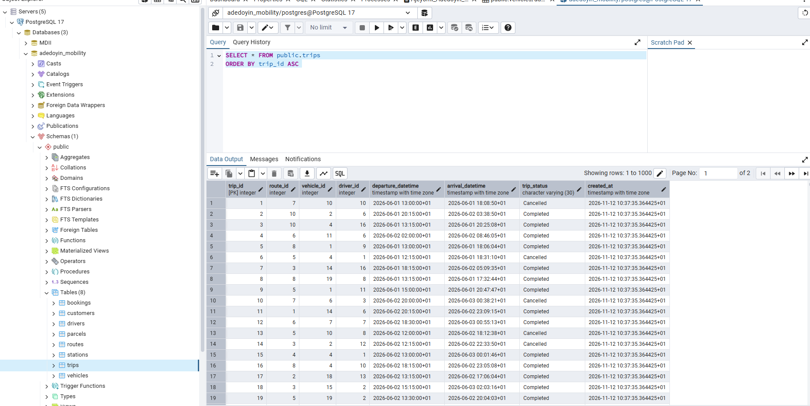
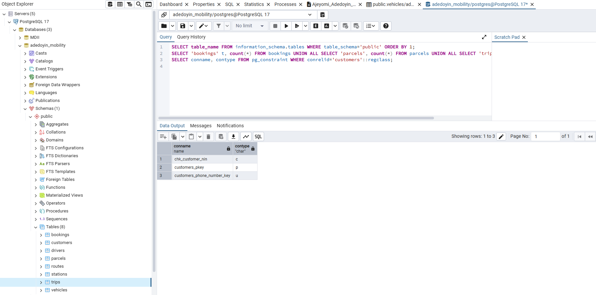
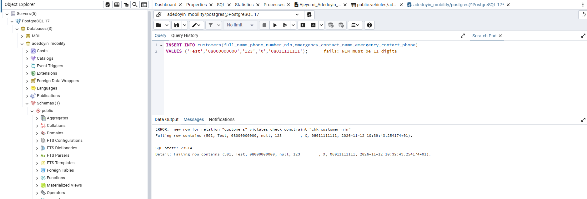

# Portfolio 1: Database Design

Student Name: Adedoyin Ajeyomi
Student ID: 20260520
Course: MIT 8103 - Advanced Database Systems
Case Study: Adedoyin Mobility and Logistics
Database: PostgreSQL 17.5

---

## 1. The company

Adedoyin Mobility and Logistics is a Nigerian transport company. It sells seats on buses and minivans between cities, and it carries parcels between the same cities.

- 20 vehicles: Toyota HiAce buses (14 to 18 seats) and Toyota Sienna minivans (7 to 8 seats).
- 6 stations: Lagos (Ojota), Ibadan (Iwo Road), Abuja (Utako), Benin City (Ramat Park), Enugu (Holy Ghost) and Kano (Sabon Gari).

The system does two jobs. Passengers pick a trip, choose a seat and pay. Parcels are dropped at one station and sent to another, and each parcel gets a waybill number so it can be tracked.

## 2. Who uses the database

- Station managers schedule trips and receive parcels.
- Fleet managers watch vehicles, drivers, seats and deliveries.
- Booking and parcel clerks register customers, sell seats and issue waybills.
- Drivers are linked to a vehicle and to trips, with a verified identity and licence.
- Customers book seats and send parcels.
- Finance and compliance staff check revenue per route and print passenger lists for the road safety rules (FRSC).

## 3. What the database stores

Because of road safety rules, the database keeps identity details (called KYC):

- Drivers: name, phone, NIN, licence number and licence expiry date.
- Customers: name, phone, NIN, and an emergency contact.
- Vehicles: plate number, chassis number, GPS tracker code and roadworthiness expiry date.
- Parcels: sender, recipient name and phone, and the recipient's NIN, so the right person collects the parcel.

## 4. The ER diagram

I designed 8 tables. The diagram uses Crow's Foot symbols. A single bar means one, a circle means zero, and the three-pronged foot means many. So `||` is exactly one, `o|` is zero or one, and `o<` is zero or many. PK is a primary key, FK a foreign key and UK a unique key.

How the tables connect:

- One station has many vehicles.
- One station is the start of many routes and the end of many routes. This is two lines on the diagram, labelled origin and destination.
- One vehicle has at most one main driver (1 to 1). A `UNIQUE` rule on `drivers.assigned_vehicle_id` enforces this.
- One route has many trips. One vehicle and one driver each have many trips.
- One trip has many bookings and many parcels. A parcel can be registered before it is loaded on a trip, so `parcels.trip_id` may be empty.
- One customer has many bookings and sends many parcels.

## 5. The 8 tables

- `stations`: the 6 stations, with address, phone and manager.
- `vehicles`: plate, chassis, model, seats, GPS code and status.
- `drivers`: name, NIN, licence, licence expiry and status.
- `customers`: name, phone, NIN and emergency contact.
- `routes`: start station, end station, distance, travel time and base prices.
- `trips`: one scheduled journey, with its route, vehicle, driver, times and status.
- `bookings`: one seat bought by one customer on one trip, with the price and payment reference.
- `parcels`: one parcel with its waybill number, weight, value, sender, recipient and status.

## 6. Keys and rules

Every table has a primary key. Foreign keys link the tables. Some columns must be unique, such as plate numbers, NINs, licence numbers and waybill numbers.

These rules are built into the database:

1. A seat cannot be sold twice on the same trip (`UNIQUE (trip_id, seat_number)`).
2. A vehicle has between 7 and 18 seats.
3. A route cannot start and end at the same station.
4. A trip cannot arrive before it leaves.
5. Prices, distances and parcel weights must be more than zero.
6. A NIN must have exactly 11 digits. This is checked for drivers, for customers (when a NIN is given) and for parcel recipients (when a NIN is given).

## 7. Normalisation

Normalisation means organising data so the same fact is not stored twice. This avoids mistakes when data is added, changed or deleted.

Here is one record before normalisation:

| trip | route | departure | plate | driver | driver_nin | passengers (seat) | parcels |
| :--- | :--- | :--- | :--- | :--- | :--- | :--- | :--- |
| 1001 | Lagos to Ibadan | 2026-06-01 07:00 | APP-125KT | Musa Bello | 12345678901 | Ade (1), Bola (2), Chi (3) | WB-01, WB-02 |

This one row has repeating groups (three passengers, two parcels). It also repeats the driver and vehicle facts every time the trip appears.

- First normal form (1NF): each cell holds one value. Passengers and parcels get their own rows.
- Second normal form (2NF): every column depends on the whole key. The route, plate and driver depend only on the trip, and customer details depend only on the customer. So I moved them into `trips`, `customers` and `routes`.
- Third normal form (3NF): no column depends on a non-key column. For example, `trip_id -> driver_id -> driver_nin`. The NIN belongs to the driver, not the trip. So drivers, vehicles and stations have their own tables.
- BCNF: every column that decides other columns is a candidate key. The candidate keys are:
  - `stations`: `station_id`, `station_name`
  - `vehicles`: `vehicle_id`, `registration_number`, `chassis_number`, `gps_tracker_id`
  - `drivers`: `driver_id`, `phone_number`, `nin`, `license_number`, `assigned_vehicle_id`
  - `customers`: `customer_id`, `phone_number`
  - `routes`: `route_id`, and the pair `(origin_station_id, destination_station_id)`
  - `trips`: `trip_id`
  - `bookings`: `booking_id`, the pair `(trip_id, seat_number)`, and `payment_reference`
  - `parcels`: `parcel_id`, `waybill_number`

One choice may look like repeated data: `bookings.ticket_amount` stores the price that was actually paid. Fares change over time, so the booking keeps the price at the moment of sale. It is a history record, not a repeat.

## 8. How to run it in pgAdmin 4

1. Right-click Databases, choose Create, then Database. Name it `adedoyin_mobility`.
2. Open a Query Tool on that database, open `Ajeyomi_Adedoyin_20260520_Schema.sql` and press F5. This builds the 8 tables.
3. Load the data with one of these two (not both, because they fill the same tables):
   - `Ajeyomi_Adedoyin_20260520_Seed_Data.sql`: plain SQL inserts. It runs directly in pgAdmin 4.
   - `Ajeyomi_Adedoyin_20260520_Copy_From_CSV.sql`: loads the full dataset (8,000 bookings, 3,500 parcels, 1,200 trips) from the `data` folder. It uses the `psql` command `\copy`, so run it from `psql` in the repository root.

## 9. Screenshots

All screenshots are from pgAdmin 4 on PostgreSQL 17, database `adedoyin_mobility`.

The 8 tables are created and the `trips` table has data:

The constraints stored on the `customers` table: the primary key, the unique phone number and the NIN check:

A rule at work: a customer with a 3 digit NIN is refused by `chk_customer_nin`:

