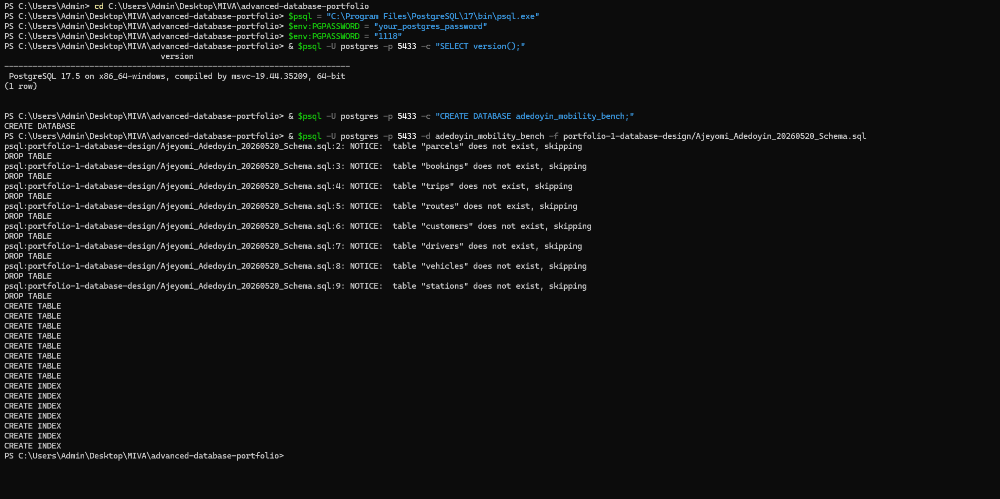
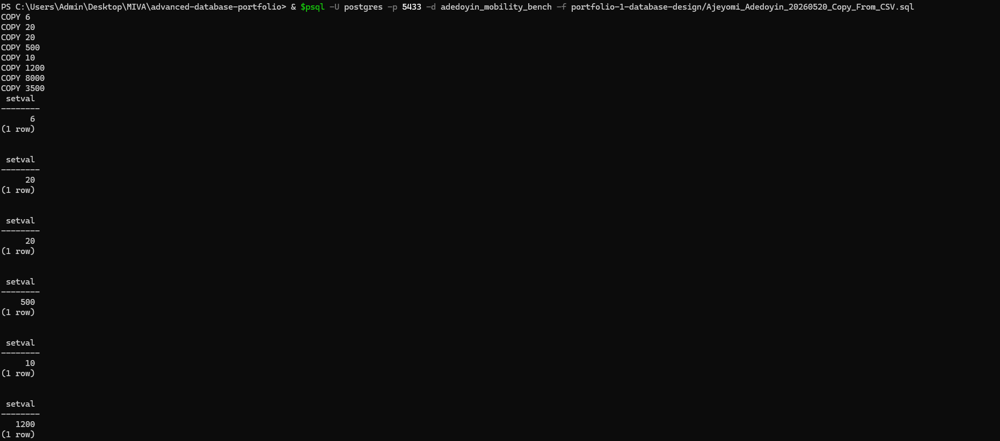
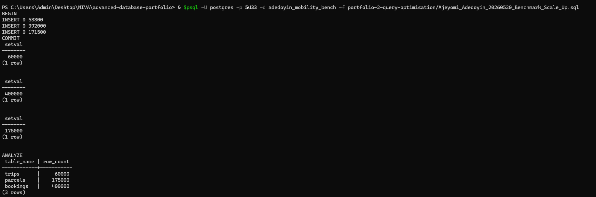
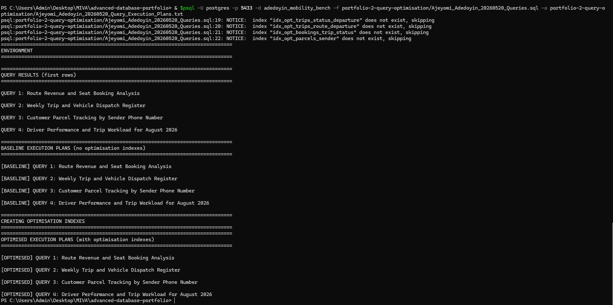

# Portfolio 2: Query Processing and Optimisation

Student Name: Adedoyin Ajeyomi
Student ID: 20260520
Course: MIT 8103 - Advanced Database Systems
Case Study: Adedoyin Mobility and Logistics
Database: PostgreSQL 17.5

---

## 1. What this portfolio is about

A query that gives the right answer is only the first step. When a table grows, a query without a good index gets slow. In my company this matters: ticket agents need fast answers, customers want parcel updates quickly, and managers need reports on trips and drivers.

When I run a query, PostgreSQL chooses the cheapest way to run it. I can see its choice with `EXPLAIN (ANALYZE, BUFFERS)`. In this portfolio I wrote four business queries, looked at their plans, added indexes, and measured the difference.

## 2. The four queries

All four run on my real data and return rows. The first rows of every result are in the plans file.

1. Route revenue: the tickets sold and money earned on each route for completed trips in July 2026. (Tables: routes, stations, trips, bookings.)
2. Weekly dispatch register: all trips on one route in one week, with their vehicles and drivers. (Tables: trips, routes, stations, vehicles, drivers.)
3. Parcel tracking: every parcel sent by one customer, found by the customer's phone number, newest first. (Tables: customers, parcels.)
4. Driver workload: completed trips and confirmed passengers for each driver in August 2026. (Tables: drivers, trips, bookings.)

## 3. How to read an execution plan

`EXPLAIN (ANALYZE, BUFFERS)` shows four things:

- The scan type. A `Seq Scan` reads every row of a table. An `Index Scan` or `Bitmap Index Scan` jumps straight to the matching rows.
- The cost. This is PostgreSQL's own estimate. Lower is better.
- The execution time in milliseconds.
- The buffers. These are the 8 KB memory pages read. Fewer pages means less work.

## 4. The indexes

My Portfolio 1 schema already had a few basic indexes. To get a fair baseline, the benchmark script first removes them, so the baseline only has the primary key and unique indexes. Then it creates these four:

    CREATE INDEX idx_opt_trips_status_departure
        ON trips (trip_status, departure_datetime) INCLUDE (route_id, driver_id);

    CREATE INDEX idx_opt_trips_route_departure
        ON trips (route_id, departure_datetime);

    CREATE INDEX idx_opt_bookings_trip_status
        ON bookings (trip_id, booking_status) INCLUDE (ticket_amount);

    CREATE INDEX idx_opt_parcels_sender
        ON parcels (sender_customer_id, created_at DESC);

- The first serves queries 1 and 4. It finds completed trips in a date range without reading every trip.
- The second serves query 2. It finds one route's trips inside a week.
- The third serves queries 1 and 4. It is a covering index: `INCLUDE` stores the ticket amount inside the index, so PostgreSQL does not need to visit the table for it.
- The fourth serves query 3. It finds one sender's parcels, already in order.

## 5. The benchmark

My real data (1,200 trips, 8,000 bookings, 3,500 parcels) is so small that PostgreSQL reads each table in a few memory pages and never needs an index. So I copied the real records 50 times into a separate database, `adedoyin_mobility_bench`. It has 60,000 trips, 400,000 bookings and 175,000 parcels. The copies have new keys and shifted trip dates. The script is `Ajeyomi_Adedoyin_20260520_Benchmark_Scale_Up.sql`. My main database `adedoyin_mobility` is not changed.

Other details of the test:

- Every number comes from `EXPLAIN (ANALYZE, BUFFERS)` on my own PostgreSQL 17.5. The unedited output is in `Ajeyomi_Adedoyin_20260520_Query_Execution_Plans.txt`.
- The extra Portfolio 1 indexes were removed before the baseline run.
- Parallel query and JIT were switched off, and each query was run once as a warm-up before its recorded plan.

| Query | Before | After | Speedup | Cost before | Cost after | Pages read |
| :--- | :---: | :---: | :---: | :---: | :---: | :---: |
| 1: Route revenue | 7.61 ms | 1.30 ms | 5.8x | 6510.48 | 4761.85 | 1,550 to 949 |
| 2: Weekly dispatch | 5.36 ms | 0.10 ms | 51.1x | 1680.23 | 36.88 | 624 to 10 |
| 3: Parcel tracking | 20.41 ms | 0.31 ms | 65.4x | 5105.24 | 1023.15 | 2,871 to 406 |
| 4: Driver workload | 6.39 ms | 1.32 ms | 4.8x | 6190.24 | 4734.20 | 1,538 to 934 |

## 6. What the plans show

- Queries 2 and 3 gain the most. They look for a small group of rows in a very large table, so a `Seq Scan` over every row becomes a `Bitmap Index Scan` that touches only the matching pages. For query 2 the pages read fall from 624 to 10.
- Queries 1 and 4 gain less. They still have to read thousands of bookings to build their totals. The `Seq Scan` on trips becomes a `Bitmap Index Scan`, and the booking lookups use the covering index.
- The cost estimate falls in every query, which agrees with the measured times.

This is the graphical plan from pgAdmin 4 for query 2 with the index. It uses `idx_opt_trips_route_departure`, then joins to routes, stations, vehicles and drivers, and sorts at the end.

## 7. Limits of the results

Execution times change a little from run to run, for example when other programs are busy on the computer, so treat the milliseconds as a guide. The change of scan type and the drop in pages read are the steady evidence. The data is also a scaled copy of my records, not real company data.

## 8. Why not index every column?

Indexes speed up reading, but they cost something:

1. Writing is slower. Every new booking or status change must also update every index on the table.
2. Indexes use disk space and memory.
3. Indexes need care over time. After many updates they can need rebuilding with `REINDEX`.

So I only index columns that queries really use to filter, join or sort.

## 9. Screenshots of the setup

Creating the benchmark database and the tables:

Loading the real data (1,200 trips, 8,000 bookings, 3,500 parcels):

Scaling the data up to 60,000 trips, 400,000 bookings and 175,000 parcels:

Running the queries and saving the plans:

## 10. How to run it again

Open PowerShell in the repository folder. Change `-p 5433` to your PostgreSQL port (normally 5432) and set `$env:PGPASSWORD` first.

    $psql = "C:\Program Files\PostgreSQL\17\bin\psql.exe"

    & $psql -U postgres -p 5433 -c "CREATE DATABASE adedoyin_mobility_bench;"
    & $psql -U postgres -p 5433 -d adedoyin_mobility_bench -f portfolio-1-database-design/Ajeyomi_Adedoyin_20260520_Schema.sql
    & $psql -U postgres -p 5433 -d adedoyin_mobility_bench -f portfolio-1-database-design/Ajeyomi_Adedoyin_20260520_Copy_From_CSV.sql
    & $psql -U postgres -p 5433 -d adedoyin_mobility_bench -f portfolio-2-query-optimisation/Ajeyomi_Adedoyin_20260520_Benchmark_Scale_Up.sql
    & $psql -U postgres -p 5433 -d adedoyin_mobility_bench -f portfolio-2-query-optimisation/Ajeyomi_Adedoyin_20260520_Queries.sql -o portfolio-2-query-optimisation/Ajeyomi_Adedoyin_20260520_Query_Execution_Plans.txt

## 11. Files

- `Ajeyomi_Adedoyin_20260520_Queries.sql`: the four queries, the baseline, the indexes and the optimised plans.
- `Ajeyomi_Adedoyin_20260520_Benchmark_Scale_Up.sql`: makes the 50 copies of the data.
- `Ajeyomi_Adedoyin_20260520_Query_Execution_Plans.txt`: the real output.
- `assets/`: the chart and the screenshots.
