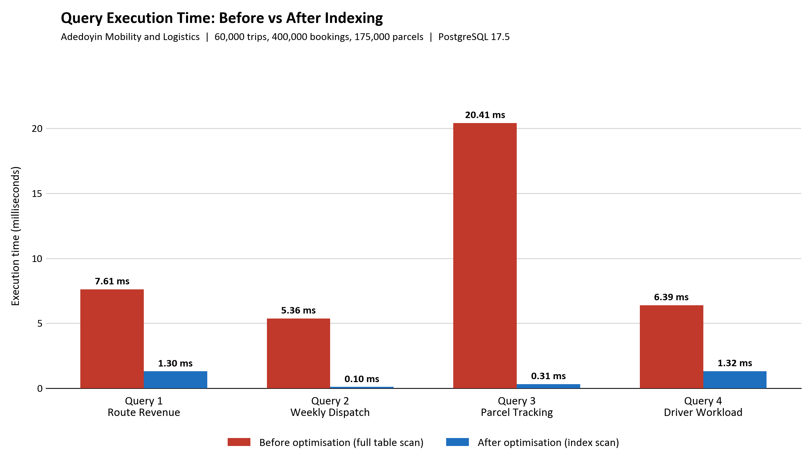
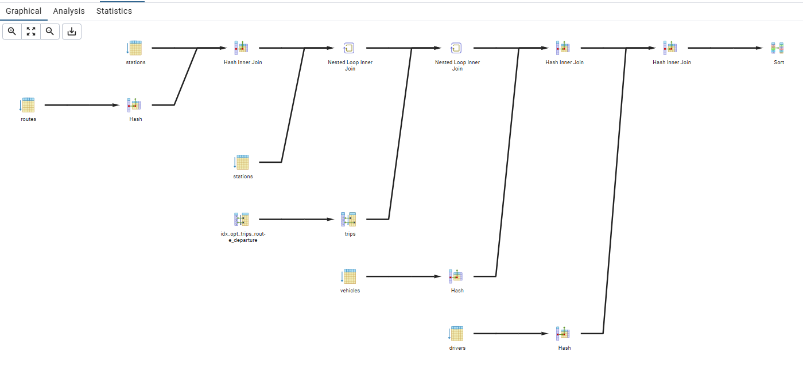

# Portfolio 2: Query Processing and Optimisation

**Student Name:** Adedoyin Ajeyomi  
**Student ID:** 20260520  
**Course:** MIT 8103 - Advanced Database Systems  
**Case Study:** Adedoyin Mobility and Logistics  
**Database Engine:** PostgreSQL 17.5  

---

## 1. Introduction to Query Processing and Optimisation

In any database system, writing SQL queries that return correct data is only the first step. When an application grows and stores thousands or millions of records, poorly structured queries or missing indexes can cause the system to slow down significantly.

**Query Optimisation** is the process where the database engine (the query planner) determines the most efficient way to execute a given SQL statement. 

For **Adedoyin Mobility and Logistics**, fast database queries are critical:
- Ticket booking agents at terminals need instant seat availability.
- Customers tracking urgent packages expect real-time delivery status.
- Fleet supervisors need quick reports on daily trip revenue and driver performance.

This portfolio module demonstrates how to write four essential business queries, analyse their internal execution plans using PostgreSQL's `EXPLAIN (ANALYZE, BUFFERS)`, identify performance bottlenecks, and resolve them using targeted indexing strategies.

---

## 2. The Four Core Business Queries

We designed four realistic queries representing the day-to-day operations of Adedoyin Mobility and Logistics. All four were written against the real data and each returns rows (the first rows of every result are recorded in the plans file).

### Query 1: Route Revenue and Seat Booking Analysis
- **Business Need:** Management wants ticket sales and revenue for each travel corridor (for example Lagos to Abuja) for completed trips in July 2026.
- **Tables Used:** `routes`, `stations` (origin and destination), `trips`, and `bookings`.
- **Key Operations:** Multi-table `JOIN`, filtering on trip status, a date range and confirmed bookings, and `SUM()` / `AVG()` aggregation.

### Query 2: Weekly Trip and Vehicle Dispatch Register
- **Business Need:** Dispatch officers check every trip, vehicle and driver on one route for one week.
- **Tables Used:** `trips`, `routes`, `vehicles`, `drivers`, and `stations`.
- **Key Operations:** Filter on `route_id` and a date range on `departure_datetime`, six-table `JOIN`, and `ORDER BY departure_datetime`.

### Query 3: Customer Parcel Tracking by Sender Phone Number
- **Business Need:** Customer care looks up every parcel a customer has sent, newest first, using the customer's phone number.
- **Tables Used:** `customers` and `parcels`.
- **Key Operations:** Equality search on `customers.phone_number`, a join to `parcels` on the sender, and `ORDER BY created_at DESC`.

### Query 4: Driver Performance and Trip Workload for August 2026
- **Business Need:** Supervisors compare drivers by completed trips and confirmed passengers carried in August 2026.
- **Tables Used:** `drivers`, `trips`, and `bookings`.
- **Key Operations:** `LEFT JOIN`, `COUNT(DISTINCT trip_id)`, `COUNT(booking_id)`, grouping by driver, and a date range filter.

---

## 3. Understanding Execution Plans: `EXPLAIN (ANALYZE, BUFFERS)`

To inspect how PostgreSQL executes a query, we prefix the query with:
```sql
EXPLAIN (ANALYZE, BUFFERS) <query>;
```

This command provides four crucial pieces of technical evidence:
1. **Node Type:** The algorithm used to retrieve and process data (e.g., `Seq Scan`, `Index Scan`, `Bitmap Index Scan`, `Hash Join`, `Nested Loop`).
2. **Estimated Cost (`cost=min..max`):** An arbitrary cost unit used by the planner to compare execution paths. Lower numbers mean less computational work.
3. **Execution Time (`actual time` in milliseconds):** The real clock time taken to execute the query and return results.
4. **Shared Buffers (`shared hit`):** The number of 8KB database memory pages read from cache or disk. Fewer page reads indicate a more efficient query.

### The Problem: Sequential Scans (`Seq Scan`)
Without appropriate indexes, the database must perform a **Sequential Scan**, reading every single row in the table from disk/memory and checking each row against the `WHERE` condition. On large tables like `trips` (60,000 rows), `bookings` (400,000 rows) and `parcels` (175,000 rows) in our benchmark database, this wastes CPU cycles and memory bandwidth.

---

## 4. Indexing Strategies Applied

The Portfolio 1 schema already creates a few basic indexes. To get a fair baseline, the benchmark script first drops those extra indexes, so the baseline only has the primary key and unique constraint indexes. It then creates the four indexes below.

### 1. Composite B-Tree Indexes
When a query filters by two or more columns together, a composite index lets the engine jump straight to the matching entries.
```sql
CREATE INDEX idx_opt_trips_status_departure
    ON trips (trip_status, departure_datetime) INCLUDE (route_id, driver_id);

CREATE INDEX idx_opt_trips_route_departure
    ON trips (route_id, departure_datetime);

CREATE INDEX idx_opt_parcels_sender
    ON parcels (sender_customer_id, created_at DESC);
```
- `idx_opt_trips_status_departure` serves Queries 1 and 4: it finds completed trips in a date range without scanning every trip.
- `idx_opt_trips_route_departure` serves Query 2: it finds one route's trips inside a week.
- `idx_opt_parcels_sender` serves Query 3: it finds one sender's parcels, already ordered newest first.

### 2. Covering Index (`INCLUDE` Clause)
A covering index stores extra columns in the index itself, so the engine does not need to visit the table for them.
```sql
CREATE INDEX idx_opt_bookings_trip_status
    ON bookings (trip_id, booking_status) INCLUDE (ticket_amount);
```
Queries 1 and 4 read `ticket_amount` and `booking_status` for every booking of the selected trips. With this index both values come straight from the index.

---

## 5. Performance Benchmark Results (Before vs After)

### 5.1 How the benchmark was run
- **Real output:** every number below comes from `EXPLAIN (ANALYZE, BUFFERS)` on PostgreSQL 17.5 on my own computer. The unedited output is in [`Ajeyomi_Adedoyin_20260520_Query_Execution_Plans.txt`](Ajeyomi_Adedoyin_20260520_Query_Execution_Plans.txt).
- **Scaled test database:** the real dataset (1,200 trips, 8,000 bookings, 3,500 parcels) is so small that PostgreSQL reads each table in a few memory pages and never needs an index. So the real records were copied 50 times into a separate database, `adedoyin_mobility_bench`, giving 60,000 trips, 400,000 bookings and 175,000 parcels. The copies have new keys and shifted trip dates. The script is [`Ajeyomi_Adedoyin_20260520_Benchmark_Scale_Up.sql`](Ajeyomi_Adedoyin_20260520_Benchmark_Scale_Up.sql). The main database `adedoyin_mobility` is unchanged.
- **Fair baseline:** the extra Portfolio 1 indexes were dropped before the baseline run.
- **Repeatable settings:** parallel query and JIT were switched off, and each query was run once as a warm-up before the recorded plan, so the plan reflects cached data.



| Query | Baseline Time | Optimised Time | Speedup | Baseline Cost | Optimised Cost | Buffers Read (Before → After) |
| :--- | :---: | :---: | :---: | :---: | :---: | :---: |
| **Query 1: Route Revenue** | 7.61 ms | 1.30 ms | 5.8x | 6510.48 | 4761.85 | 1,550 → 949 pages |
| **Query 2: Weekly Dispatch** | 5.36 ms | 0.10 ms | 51.1x | 1680.23 | 36.88 | 624 → 10 pages |
| **Query 3: Parcel Tracking** | 20.41 ms | 0.31 ms | 65.4x | 5105.24 | 1023.15 | 2,871 → 406 pages |
| **Query 4: Driver Workload** | 6.39 ms | 1.32 ms | 4.8x | 6190.24 | 4734.20 | 1,538 → 934 pages |

### 5.2 What the plans show
- **Query 2 and Query 3** gain the most (51.1x and 65.4x). Both look for a small group of rows in a very large table, so a `Seq Scan` over every row is replaced by a `Bitmap Index Scan` that touches only the matching pages (Query 2 drops from 624 to 10 buffer pages).
- **Query 1 and Query 4** gain less (5.8x and 4.8x). They still need to read thousands of bookings to build the totals. The `Seq Scan on trips` becomes a `Bitmap Index Scan` on `idx_opt_trips_status_departure`, and the booking lookups use `idx_opt_bookings_trip_status`.
- **Cost** is the planner's own estimate and it falls in every query, which agrees with the measured times.

**Graphical plan in pgAdmin 4 (Query 2, with the index):** the flowchart shows `idx_opt_trips_route_departure` feeding the `trips` scan, followed by the joins to routes, stations, vehicles and drivers, and a final sort.



### 5.3 Limits of these results
Execution times vary a little from run to run (for example with background activity on the computer), so treat the milliseconds as indicative. The change in plan type and the drop in buffer pages are the stable evidence. The data is also a scaled copy of the real records, not production data.

---

## 6. Practical Trade-offs: Why Not Index Every Column?

While indexes dramatically speed up read operations (`SELECT`), they introduce trade-offs that a database engineer must balance:

1. **Write Overhead:** Every time a new ticket is booked (`INSERT`) or a trip changes status (`UPDATE`), the database must update both the table and all associated indexes. Having too many indexes slows down write-heavy transactions.
2. **Disk and RAM Storage:** Indexes consume additional disk space and database shared memory (`shared_buffers`). Indexes should only be created on columns that appear frequently in `WHERE`, `JOIN`, `ORDER BY`, or `GROUP BY` clauses.
3. **Index Maintenance:** Over time, frequent updates cause index fragmentation, requiring periodic maintenance (such as `REINDEX TABLE`).

---

## 7. How to Reproduce the Benchmark

Run the commands from the repository root in PowerShell (change `-p 5433` to your PostgreSQL port, normally `5432`). Set the password first with `$env:PGPASSWORD`.

```powershell
$psql = "C:\Program Files\PostgreSQL\17\bin\psql.exe"

# 1. Create the separate benchmark database
& $psql -U postgres -p 5433 -c "CREATE DATABASE adedoyin_mobility_bench;"

# 2. Build the tables and load the real data
& $psql -U postgres -p 5433 -d adedoyin_mobility_bench -f portfolio-1-database-design/Ajeyomi_Adedoyin_20260520_Schema.sql
& $psql -U postgres -p 5433 -d adedoyin_mobility_bench -f portfolio-1-database-design/Ajeyomi_Adedoyin_20260520_Copy_From_CSV.sql

# 3. Scale the data up to 60,000 trips, 400,000 bookings and 175,000 parcels
& $psql -U postgres -p 5433 -d adedoyin_mobility_bench -f portfolio-2-query-optimisation/Ajeyomi_Adedoyin_20260520_Benchmark_Scale_Up.sql

# 4. Run the queries and save the real execution plans
& $psql -U postgres -p 5433 -d adedoyin_mobility_bench -f portfolio-2-query-optimisation/Ajeyomi_Adedoyin_20260520_Queries.sql -o portfolio-2-query-optimisation/Ajeyomi_Adedoyin_20260520_Query_Execution_Plans.txt
```

To see a graphical plan in pgAdmin 4, open a Query Tool on `adedoyin_mobility_bench`, paste one query from `Queries.sql`, and press `Shift + F7` (Explain Analyze).
