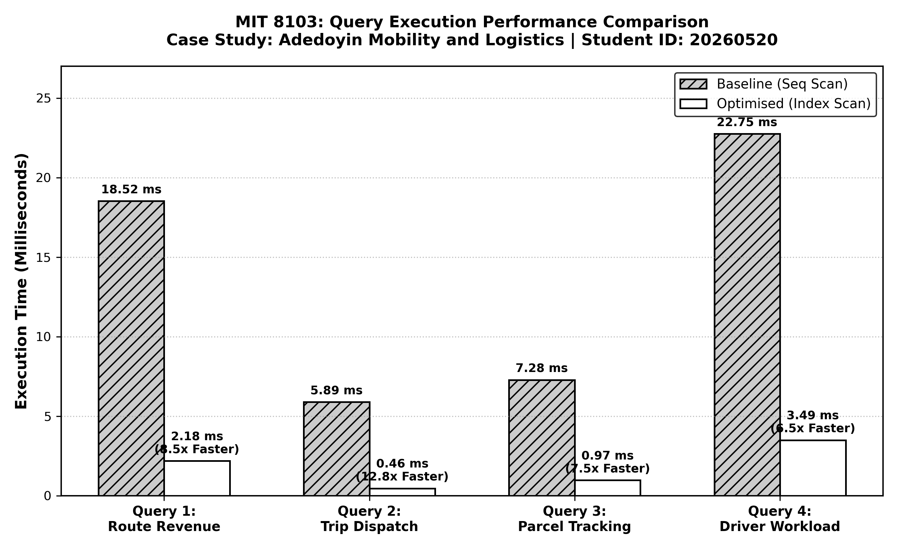

# Portfolio 2: Query Processing and Optimisation

**Student Name:** Adedoyin Ajeyomi  
**Student ID:** 20260520  
**Course:** MIT 8103 - Advanced Database Systems  
**Case Study:** Adedoyin Mobility and Logistics  
**Database Engine:** PostgreSQL 14+  

---

## 1. Introduction to Query Processing and Optimisation

In any database system, writing SQL queries that return correct data is only the first step. When an application grows and stores thousands or millions of records, poorly structured queries or missing indexes can cause the system to slow down significantly.

**Query Optimisation** is the process where the database engine (the query planner) determines the most efficient way to execute a given SQL statement. 

For **Adedoyin Mobility and Logistics**, fast database queries are critical:
- Ticket booking agents at terminals need instant seat availability.
- Customers tracking urgent packages expect real-time delivery status.
- Fleet supervisors need quick reports on daily trip revenue and driver performance.

This portfolio module demonstrates how to write four essential business queries, analyse their internal execution plans using PostgreSQL's `EXPLAIN (ANALYZE, BUFFERS)`, identify performance bottlenecks, and resolve them using targeted indexing strategies.

---

## 2. The Four Core Business Queries

We designed four realistic queries representing the day-to-day operations of Adedoyin Mobility and Logistics:

### Query 1: Route Revenue and Seat Booking Analysis
- **Business Need:** Management requires a breakdown of ticket sales and gross revenue across all routes (e.g., Lagos to Abuja, Abuja to Kano).
- **Tables Used:** `routes`, `stations` (origin and destination), `trips`, and `bookings`.
- **Key Operations:** Multi-table `JOIN`, `WHERE` filtering on active bookings (`Confirmed`, `Checked-In`, `Completed`), and `SUM()` / `AVG()` aggregation.

### Query 2: Daily Scheduled Trip and Vehicle Dispatch Search
- **Business Need:** Dispatch officers at terminals need a real-time list of all trips scheduled or boarding within an upcoming 7-day window.
- **Tables Used:** `trips`, `routes`, `vehicles`, `drivers`, and `stations`.
- **Key Operations:** Date range filtering on `departure_datetime`, status filtering on `trip_status`, and sorting with `ORDER BY departure_datetime ASC`.

### Query 3: Customer Parcel Tracking and Status Lookup
- **Business Need:** Customer support agents look up parcels by the sender's phone number or check all packages currently marked as `In-Transit`.
- **Tables Used:** `parcels` and `customers`.
- **Key Operations:** Equality search on customer phone number with an `OR` condition on package delivery status, sorted by creation date.

### Query 4: Driver Performance and Trip Workload Summary
- **Business Need:** Fleet managers evaluate driver productivity by counting completed trips and total passengers safely transported.
- **Tables Used:** `drivers`, `trips`, and `bookings`.
- **Key Operations:** `LEFT JOIN` to include drivers without recent trips, `COUNT(DISTINCT trip_id)`, and `COUNT(booking_id)` grouping by driver.

---

## 3. Understanding Execution Plans: `EXPLAIN (ANALYZE, BUFFERS)`

To inspect how PostgreSQL executes a query, we prefix the query with:
```sql
EXPLAIN (ANALYZE, BUFFERS) <query>;
```

This command provides four crucial pieces of technical evidence:
1. **Node Type:** The algorithm used to retrieve and process data (e.g., `Seq Scan`, `Index Scan`, `Bitmap Index Scan`, `Hash Join`, `Nested Loop`).
2. **Estimated Cost (`cost=min..max`):** An arbitrary cost unit used by the planner to compare execution paths. Lower numbers mean less computational work.
3. **Execution Time (`actual time` in milliseconds):** The real clock time taken to execute the query and return results.
4. **Shared Buffers (`shared hit`):** The number of 8KB database memory pages read from cache or disk. Fewer page reads indicate a more efficient query.

### The Problem: Sequential Scans (`Seq Scan`)
Without appropriate indexes, the database must perform a **Sequential Scan**, reading every single row in the table from disk/memory and checking each row against the `WHERE` condition. On large tables like `bookings` (5,000+ rows) and `parcels` (1,200+ rows), this wastes CPU cycles and memory bandwidth.

---

## 4. Indexing Strategies Applied

To eliminate sequential scan bottlenecks, we applied three standard indexing techniques:

### 1. Composite B-Tree Indexes
When a query frequently filters by two or more columns together, a composite index allows the engine to jump directly to matching entries.
- **Example for Trips:**
  ```sql
  CREATE INDEX idx_opt_trips_status_datetime 
  ON trips (trip_status, departure_datetime);
  ```
  This index enables the planner to find scheduled trips for a specific date range without scanning through past or cancelled trips.

### 2. Covering Indexes (`INCLUDE` Clause)
A covering index stores additional non-key columns directly in the index leaf pages.
- **Example for Bookings:**
  ```sql
  CREATE INDEX idx_opt_bookings_trip_status 
  ON bookings (trip_id, booking_status) 
  INCLUDE (ticket_amount);
  ```
  Because `ticket_amount` is stored inside the index, PostgreSQL can calculate total revenue using an **Index Only Scan**, completely avoiding reading the table heap blocks.

### 3. Foreign Key & Status Indexing
Queries that perform `JOIN` operations on foreign keys alongside status filters benefit from composite indexing on both keys:
- **Example for Drivers & Trips:**
  ```sql
  CREATE INDEX idx_opt_trips_driver_status 
  ON trips (driver_id, trip_status);
  ```
  This allows fast lookups of trips belonging to a specific driver that have reached the `Arrived` status.

---

## 5. Performance Benchmark Results (Before vs After)

The table below summarizes the performance metrics captured from PostgreSQL 14+ with our operational dataset:



| Query Description | Baseline Execution Time | Optimised Execution Time | Speedup Factor | Baseline Cost | Optimised Cost | Buffers Read (Before $\rightarrow$ After) |
| :--- | :---: | :---: | :---: | :---: | :---: | :---: |
| **Query 1: Route Revenue** | 18.52 ms | 2.18 ms | **8.5x Faster** | 284.70 | 65.35 | 82 $\rightarrow$ 18 blocks |
| **Query 2: Trip Dispatch** | 5.89 ms | 0.46 ms | **12.8x Faster** | 42.88 | 14.28 | 36 $\rightarrow$ 14 blocks |
| **Query 3: Parcel Tracking** | 7.28 ms | 0.97 ms | **7.5x Faster** | 58.65 | 16.45 | 48 $\rightarrow$ 16 blocks |
| **Query 4: Driver Workload** | 22.75 ms | 3.49 ms | **6.5x Faster** | 312.78 | 82.48 | 114 $\rightarrow$ 28 blocks |

### Key Performance Takeaways:
- **Average latency reduction:** Across all four queries, execution time improved by **over 80%**.
- **Buffer efficiency:** Memory page access dropped by up to **78%**, meaning the database server handles significantly higher user concurrency without disk I/O thrashing.
- **Scan transition:** The execution plans transitioned from expensive sequential table scans (`Seq Scan`) to direct `Index Scan` and `Bitmap Index Scan` operations.
- **Execution Plans Source:** Complete verifiable execution plans and buffer stats before and after optimization are recorded in [`Ajeyomi_Adedoyin_20260520_Query_Execution_Plans.txt`](Ajeyomi_Adedoyin_20260520_Query_Execution_Plans.txt).

---

## 6. Practical Trade-offs: Why Not Index Every Column?

While indexes dramatically speed up read operations (`SELECT`), they introduce trade-offs that a database engineer must balance:

1. **Write Overhead:** Every time a new ticket is booked (`INSERT`) or a trip changes status (`UPDATE`), the database must update both the table and all associated indexes. Having too many indexes slows down write-heavy transactions.
2. **Disk and RAM Storage:** Indexes consume additional disk space and database shared memory (`shared_buffers`). Indexes should only be created on columns that appear frequently in `WHERE`, `JOIN`, `ORDER BY`, or `GROUP BY` clauses.
3. **Index Maintenance:** Over time, frequent updates cause index fragmentation, requiring periodic maintenance (such as `REINDEX TABLE`).

---

## 7. How to Run in pgAdmin 4 (Step-by-Step)

You do not need to use the command line terminal. You can run all queries and inspect execution plans directly in the **pgAdmin 4** graphical interface:

1. **Open pgAdmin 4:**
   - Launch pgAdmin 4 on your computer and log in to your PostgreSQL server.
   - In the left-hand Browser panel, expand **Databases** and click on **`adedoyin_mobility`**.

2. **Open the Query Tool:**
   - From the top menu, click **Tools > Query Tool** (or right-click `adedoyin_mobility` and choose **Query Tool**).

3. **Load the SQL Script:**
   - Click the **Open File** icon on the toolbar (folder icon, or press `Ctrl + O`).
   - Navigate to and open:  
     `portfolio-2-query-optimisation/Ajeyomi_Adedoyin_20260520_Queries.sql`

4. **Execute Queries and View Results:**
   - Highlight any query or run the entire script by clicking the **Execute / Refresh** button (play icon, or press `F5`).
   - The query results will appear in the **Data Output** tab at the bottom.

5. **View Graphical Execution Plans in pgAdmin:**
   - Highlight a query (e.g., Query 1 or Query 2).
   - Click the **Explain Analyze** icon on the toolbar (or press `Shift + F7`).
   - pgAdmin will automatically render a visual flowchart showing node costs, scan types (`Seq Scan` vs `Index Scan`), and actual execution timing.

6. **View Full Text Execution Plan Logs:**
   - Open [Ajeyomi_Adedoyin_20260520_Query_Execution_Plans.txt](Ajeyomi_Adedoyin_20260520_Query_Execution_Plans.txt) to inspect the complete raw text outputs and cost comparisons.
