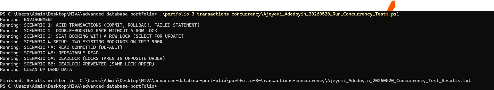
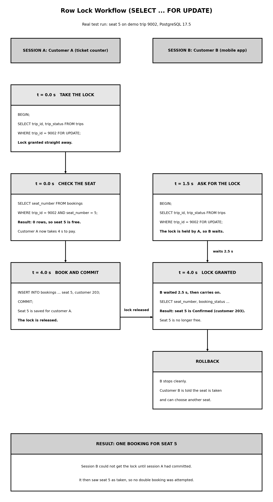

# Portfolio 3: Transactions and Concurrency

Student Name: Adedoyin Ajeyomi
Student ID: 20260520
Course: MIT 8103 - Advanced Database Systems
Case Study: Adedoyin Mobility and Logistics
Database: PostgreSQL 17.5

---

## 1. What this portfolio is about

In my case study, many people buy tickets at the same time. Customers book seats at the ticket counters in Lagos, Ibadan, Abuja, Benin City, Enugu and Kano, and on the mobile app. The database must never sell one seat twice, and it must never keep half of a booking when something goes wrong.

A transaction is a group of database steps that are treated as one job. Either every step is saved, or none of them are. In this portfolio I tested five things on my own PostgreSQL server:

1. Saving a booking with COMMIT, and cancelling one with ROLLBACK.
2. Two customers trying to take the same seat, with no lock.
3. The same two customers, with a row lock.
4. Two isolation levels, which control what a running report can see.
5. A deadlock, and how to avoid it.

## 2. How I tested

The real trips in my data are all Completed or Cancelled, and their seats are already booked. So for these tests I added four new demo trips (trip numbers 9001 to 9004) on the Lagos to Abuja route. The test script deletes them again when it finishes. After the last run my database was back to exactly 8,000 bookings, and the two vehicles I used were still Active.

To test two people acting at the same time, I wrote a PowerShell script. It starts two real database sessions at once, session A first and session B a moment later. It saves everything PostgreSQL printed, with clock times, in the results file. Nothing in the results file was typed by hand.

The script is `Ajeyomi_Adedoyin_20260520_Run_Concurrency_Tests.ps1` and the output is `Ajeyomi_Adedoyin_20260520_Concurrency_Test_Results.txt`.

Screenshot of the final run of the script in PowerShell, with all scenarios finishing and the results file written:

## 3. The four ACID rules

- Atomicity means all or nothing. A booking is fully saved or fully cancelled.
- Consistency means the rules of the database are always kept. In my database, a seat can only be booked once per trip, and a ticket price must be more than zero.
- Isolation means people working at the same time do not disturb each other.
- Durability means that after COMMIT, the data is safe, even if the power goes off.

## 4. Test 1: COMMIT, ROLLBACK and a failed statement

This test uses demo trip 9001 and is in `Ajeyomi_Adedoyin_20260520_Transactions.sql`.

- Commit: customer 101 books seat 3 for 18,500. I run COMMIT and the booking is there when I look for it afterwards.
- Rollback: customer 102 books seat 4. Inside the transaction I can see the booking. Then the "payment" fails, so I run ROLLBACK. When I look again, the booking is gone and seat 4 is free.
- Failed statement: one transaction books seat 6 correctly, then tries to book seat 7 with a price of -100. PostgreSQL refuses the second one because of my rule `chk_booking_amount`. After the error, PostgreSQL ignores every other command in that transaction ("current transaction is aborted"). I run ROLLBACK, and seat 6 is gone as well, even though that part was fine. This shows atomicity: the two seats were one job, so they were saved together or not at all.

## 5. Test 2: two customers, same seat, no lock

Customer A and customer B both want seat 5 on trip 9003. Neither session uses a lock. This is what happened in the real run:

- Session A checks seat 5 and sees it is free (0 rows). Then B checks seat 5 and also sees it is free.
- Session A inserts seat 5 first, but does not commit yet.
- Session B still believes the seat is free, so it tries to insert seat 5 as well. PostgreSQL makes B wait for about 2 seconds, until A commits.
- As soon as A commits, B fails with this error:

  `ERROR: duplicate key value violates unique constraint "uq_trip_seat_no"`

At the end, seat 5 belongs only to customer A. So there was no double booking, but only because of the rule from Portfolio 1 that a seat can be booked once per trip. Customer B only found out at the very last step, after waiting. In a real app, that could be after B has already paid.

## 6. Test 3: two customers, same seat, with a row lock

This time both sessions first run `SELECT ... FROM trips WHERE trip_id = 9002 FOR UPDATE`. This puts a lock on the trip. Only one session can hold it at a time.

- Session A asks for the lock and gets it straight away. It checks seat 5 (free), and takes about 4 seconds to "pay".
- Session B asks for the lock 1.5 seconds later. It has to wait. In the real run it waited 2.5 seconds (the output shows `Time: 2507.734 ms`).
- Session A inserts seat 5 and commits. The lock is released.
- Session B gets the lock, checks seat 5, and sees it is already Confirmed for customer 203. B does ROLLBACK and tells the customer to pick another seat.

Compared with Test 2, nobody gets an error at the last moment. The second customer learns that the seat is taken before trying to book it. I would still keep the unique rule in the database as a second safety net.

## 7. Test 4: isolation levels

Isolation decides what a running transaction can see while other people are saving new data. The test uses a finance report that adds up the ticket money for trip 9004. While the report runs, another passenger books a seat.

Read Committed (the PostgreSQL default):
- First read: 2 tickets, 37,000.
- Another passenger books a seat and commits.
- Second read, in the same transaction: 3 tickets, 55,500.

The total changed in the middle of one report.

Repeatable Read:
- First read: 3 tickets, 55,500.
- Another passenger books a seat and commits.
- Second read, in the same transaction: still 3 tickets, 55,500.
- After the report finishes with COMMIT: 4 tickets, 74,000.

The report kept the same view from start to end, which is what a finance report needs. The new booking was not lost; the report just only saw it afterwards.

## 8. Test 5: deadlock

A deadlock happens when two sessions each hold something the other one needs, so they wait for each other forever.

Test 5A (opposite order):
- Session A locks vehicle 1. Session B locks vehicle 2.
- Then A asks for vehicle 2, and B asks for vehicle 1. Each is waiting for the other.
- PostgreSQL noticed this after the `deadlock_timeout` of 1 second. In the real run, B was stopped after 1.006 seconds with `ERROR: deadlock detected`. Once B was cancelled, A was able to continue.

Test 5B (same order):
- Both sessions lock vehicle 1 first and vehicle 2 second.
- B simply waits for about 2 seconds for A to finish, and there is no deadlock.

The lesson: always take locks in the same order everywhere in the application. Both tests ended with ROLLBACK, so the vehicle statuses were not changed.

## 9. What I learned

- ROLLBACK and COMMIT keep a booking all or nothing.
- The unique rule on trip and seat is the final protection against double booking, and a row lock gives a better experience, because the second customer finds out early.
- Repeatable Read is better than Read Committed for reports that must add up correctly.
- PostgreSQL finds deadlocks by itself, but it is better to avoid them by locking in the same order.
- Locks make people wait. So transactions should be short, and a customer should not hold a lock while slowly typing card details.

## 10. How to run the tests again

Open PowerShell in the repository folder and run:

    $env:PGPASSWORD = "your_postgres_password"
    Set-ExecutionPolicy -Scope Process -ExecutionPolicy Bypass
    .\portfolio-3-transactions-concurrency\Ajeyomi_Adedoyin_20260520_Run_Concurrency_Tests.ps1

If your PostgreSQL port is not 5433, add `-Port 5432` (or your own port) at the end. The script takes about two minutes and writes a new results file.

To try a single session by hand, open `Ajeyomi_Adedoyin_20260520_Transactions.sql` in pgAdmin 4. Run one block at a time, because pgAdmin only shows the result of the last statement.

## 11. Files in this folder

- `Ajeyomi_Adedoyin_20260520_Transactions.sql`: the demo trips and the commit, rollback and failed statement tests.
- `Ajeyomi_Adedoyin_20260520_Run_Concurrency_Tests.ps1`: runs every test with two sessions at once.
- `Ajeyomi_Adedoyin_20260520_Concurrency_Test_Results.txt`: the real output.
- `assets/Ajeyomi_Adedoyin_20260520_Concurrency_Locking_Workflow.png`: the row lock diagram.
