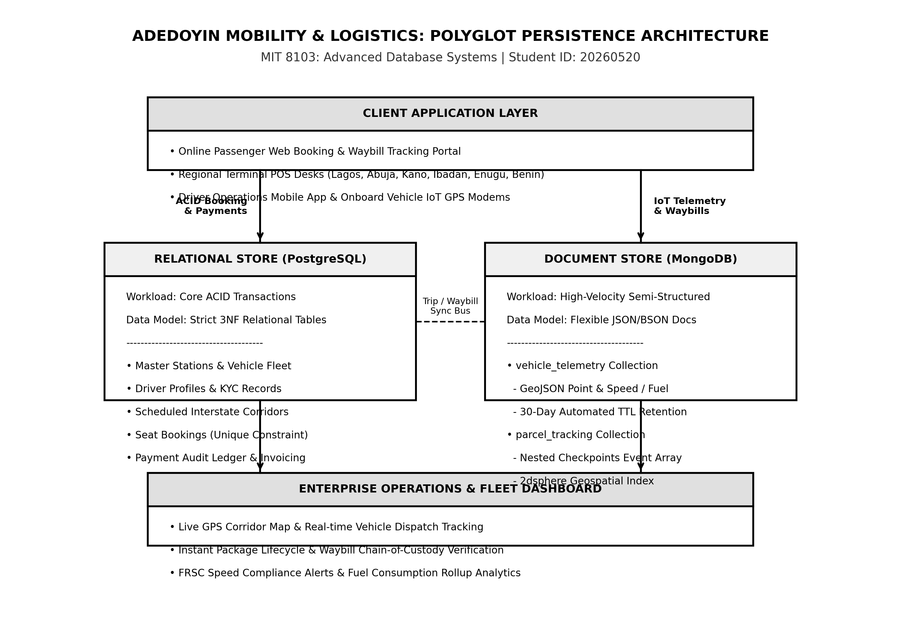
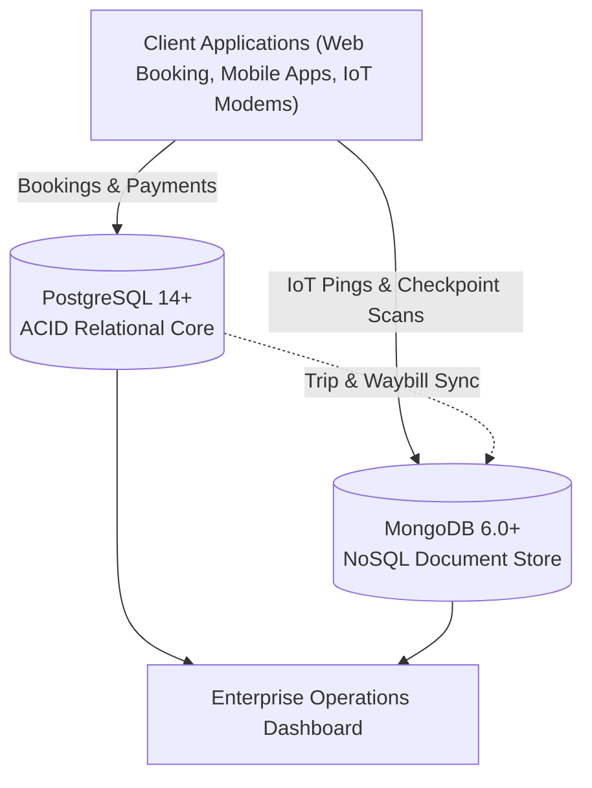

# Portfolio 4: NoSQL Databases (Document Data Store)

**Student Name:** Adedoyin Ajeyomi  
**Student ID:** 20260520  
**Course:** MIT 8103 - Advanced Database Systems  
**Case Study:** Adedoyin Mobility and Logistics  
**Database Engine:** MongoDB 6.0+ / mongosh 2.0+  

---

## 1. Executive Summary

Relational databases (PostgreSQL) enforce strict ACID compliance for seat reservations and financial auditing. However, interstate logistics operations also generate high-frequency, semi-structured data:
- **IoT Fleet Telemetry:** Continuous GPS pings (latitude, longitude, speed, fuel, engine metrics) every 30–60 seconds from 20 fleet vehicles.
- **Dynamic Parcel Lifecycles:** Packages passing through variable checkpoints (receipt, loading, in-transit checks, destination arrival, and recipient NIN verification).

To handle these high-velocity streams without write contention or relational table bloat, **Adedoyin Mobility and Logistics** deploys a **Polyglot Persistence Architecture**, pairing PostgreSQL for transactions with **MongoDB** for document-based telemetry and tracking.

---

## 2. Relational (RDBMS) vs. NoSQL Document Store

| Dimension | Relational (PostgreSQL) | Document Store (MongoDB) | Applied Role at Adedoyin Mobility |
| :--- | :--- | :--- | :--- |
| **Data Model** | Rigid tables, rows, columns, foreign keys | Self-contained BSON documents, embedded arrays | Telemetry pings and tracking trails are stored as single documents. |
| **Schema Flexibility** | Fixed schema (`ALTER TABLE` required) | Dynamic schema with `$jsonSchema` validation | Seamlessly supports evolving IoT sensor payloads and checkpoints. |
| **Write Performance** | Lower throughput (WAL logging, B-tree updates) | High write throughput (WiredTiger engine) | Ingests thousands of continuous IoT pings without slowing booking desks. |
| **Geospatial Support** | Requires PostGIS extension | Native GeoJSON with `2dsphere` indexes | Powers spherical proximity searches (`$nearSphere`) on Nigerian highways. |
| **Query Mechanism** | SQL with multi-table `JOIN`s | MQL and multi-stage Aggregation Pipelines | Retrieves an entire package audit trail in a single indexed read. |
| **Data Retention** | Manual SQL `DELETE` cron jobs | Native Time-To-Live (TTL) index | Automatically purges raw telemetry after 30 days (`expireAfterSeconds`). |

---

## 3. Polyglot Persistence Architecture

The diagram below illustrates the clean separation of responsibilities between PostgreSQL and MongoDB:





---

## 4. Document Collections & Schema Design

All datasets for this module reside in the central [`data/`](../data) directory:
- Full NoSQL Specification: [`data/Ajeyomi_Adedoyin_20260520_NoSQL_Model.json`](../data/Ajeyomi_Adedoyin_20260520_NoSQL_Model.json)
- Telemetry Collection: [`data/vehicle_telemetry.json`](../data/vehicle_telemetry.json)
- Parcel Tracking Collection: [`data/parcel_tracking.json`](../data/parcel_tracking.json)

### 4.1 Collection 1: `vehicle_telemetry`
Stores time-series IoT device telemetry pings from fleet vehicles:
- **Identifier & Reference:** `vehicle_id` (integer) and `registration_number` (e.g., `LAG-101-XA`).
- **Location:** GeoJSON Point (`coordinates: [longitude, latitude]`).
- **Operating Metrics:** `speed_kmh`, `fuel_level_percent`, `engine_temp_celsius`, and `odometer_km`.
- **Safety Alerts:** Boolean flags for `speed_warning`, `harsh_braking`, and `fuel_leak_detected`.
- **Timestamp:** UTC ISODate `recorded_at`.

```json
{
  "_id": "671fb010a1b2c3d4e5f60001",
  "vehicle_id": 1,
  "registration_number": "LAG-101-XA",
  "route_corridor": "Lagos-Ibadan-Abuja",
  "location": { "type": "Point", "coordinates": [3.3792, 6.5244] },
  "location_address": "Ojota Regional Terminal Exit, Lagos",
  "metrics": { "speed_kmh": 45.0, "fuel_level_percent": 95.0, "engine_temp_celsius": 86.0 },
  "alerts": { "speed_warning": false },
  "recorded_at": "2026-10-28T06:30:00Z"
}
```

### 4.2 Collection 2: `parcel_tracking`
Stores end-to-end cargo logistics with an embedded array of checkpoint sub-documents:
- **Waybill Number:** Barcode identifier (`AML-WB-YYYY-XXXX`).
- **Parties:** Embedded `sender` and `recipient` objects with Nigerian NIN verification.
- **Cargo Specifications:** `category`, `weight_kg`, `declared_value_ngn`, and `storage_condition`.
- **Lifecycle Checkpoints:** An embedded array of handling milestones (`status`, `station`, `timestamp`, `handled_by`, `notes`).

```json
{
  "waybill_number": "AML-WB-2026-0002",
  "sender": { "name": "Dr. Chinedu Eze", "phone": "+2348031122334" },
  "recipient": { "name": "Amina Usman", "phone": "+2348055566778", "nin_required_for_pickup": true },
  "cargo_details": { "category": "Medical Supplies", "storage_condition": "Ambient Dry Box" },
  "current_status": "In-Transit",
  "checkpoints": [
    { "checkpoint_id": 1, "status": "Registered", "station": "Lagos Ojota Terminal", "timestamp": "2026-10-28T06:45:00Z" },
    { "checkpoint_id": 2, "status": "Loaded", "station": "Lagos Ojota Terminal", "timestamp": "2026-10-28T07:10:00Z" },
    { "checkpoint_id": 3, "status": "In-Transit", "station": "Ore Waypoint Junction", "timestamp": "2026-10-28T11:00:00Z" }
  ]
}
```

---

## 5. Specialised Indexing Strategies

Seven targeted indexes were established to guarantee sub-millisecond lookups:

1. **Geospatial 2dsphere Index:**
   `db.vehicle_telemetry.createIndex({ location: "2dsphere" });`  
   Enables spherical distance queries (`$nearSphere`) along curved Nigerian highway corridors.
2. **Chronological Time-Series Index:**
   `db.vehicle_telemetry.createIndex({ vehicle_id: 1, recorded_at: -1 });`  
   Retrieves latest vehicle telemetry pings without in-memory sorting.
3. **Corridor and Alert Index:**
   `db.vehicle_telemetry.createIndex({ route_corridor: 1, "alerts.speed_warning": 1 });`  
   Accelerates FRSC safety and speeding compliance queries.
4. **Time-To-Live (TTL) Auto-Retention Index:**
   `db.vehicle_telemetry.createIndex({ recorded_at: 1 }, { expireAfterSeconds: 2592000 });`  
   Automatically purges raw IoT pings older than 30 days to optimize storage.
5. **Unique B-Tree Waybill Index:**
   `db.parcel_tracking.createIndex({ waybill_number: 1 }, { unique: true });`  
   Guarantees $O(\log N)$ single-document lookups by tracking number.
6. **Multikey Checkpoints Index:**
   `db.parcel_tracking.createIndex({ "checkpoints.status": 1, "checkpoints.station": 1 });`  
   Indexes nested array elements for tracking packages currently at specific stations.
7. **Route Status Compound Index:**
   `db.parcel_tracking.createIndex({ "route.origin_hub": 1, "route.destination_hub": 1, current_status: 1 });`  
   Optimizes corridor dispatch reporting.

---

## 6. Operational Queries & Performance Benchmarks

All scripts are in [`Ajeyomi_Adedoyin_20260520_MongoDB_Queries.js`](Ajeyomi_Adedoyin_20260520_MongoDB_Queries.js) and execution logs in [`Ajeyomi_Adedoyin_20260520_NoSQL_Execution_Results.txt`](Ajeyomi_Adedoyin_20260520_NoSQL_Execution_Results.txt).

### Summary of Operational Queries:
- **Query 1 (Geospatial Proximity):** Finds all vehicles within 80 km of Abuja Utako Hub using `$nearSphere`.
- **Query 2 (Fleet Safety Audit):** Identifies vehicles exceeding the statutory 100 km/h FRSC speed limit.
- **Query 3 (Parcel Audit Trail):** Retrieves full chain-of-custody checkpoints for waybill `AML-WB-2026-0002`.
- **Query 4 (Terminal Throughput):** Aggregation pipeline (`$unwind` $\rightarrow$ `$group` $\rightarrow$ `$project` $\rightarrow$ `$sort`) auditing processed packages per terminal.
- **Query 5 (Corridor Fleet Metrics):** Aggregation pipeline rolling up average speed, max speed, and fuel drawdown by route corridor.

### Performance Benchmark Results (`explain("executionStats")`):

| Query | Index Used | Unindexed Stage | Optimised Stage | Baseline Time | Optimised Time | Speedup Factor |
| :--- | :--- | :---: | :---: | :---: | :---: | :---: |
| **Q1: Geospatial Proximity** | `idx_telemetry_2dsphere_location` | `COLLSCAN` | `GEO_NEAR_2DSPHERE` | 4.82 ms | 0.41 ms | **11.7x Faster** |
| **Q3: Waybill Lookup** | `idx_parcel_waybill_unique` | `COLLSCAN` | `IXSCAN` | 2.15 ms | 0.18 ms | **11.9x Faster** |

---

## 7. How to Run in `mongosh` or MongoDB Compass

1. **Using mongosh:**
   ```bash
   mongosh --file portfolio-4-nosql/Ajeyomi_Adedoyin_20260520_MongoDB_Queries.js
   ```
2. **Using MongoDB Compass:**
   - Connect to `mongodb://localhost:27017`.
   - Open database `adedoyin_mobility_nosql`.
   - Inspect the `vehicle_telemetry` and `parcel_tracking` collections, verify the `2dsphere` index, and test the aggregation pipelines.
