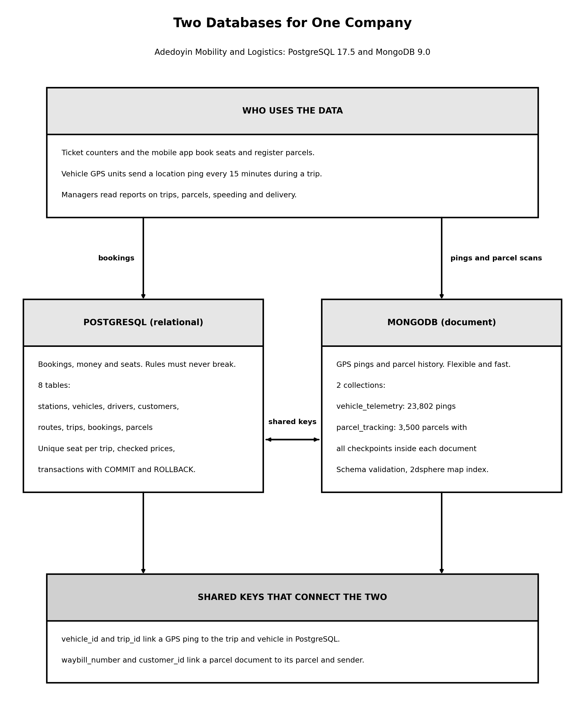
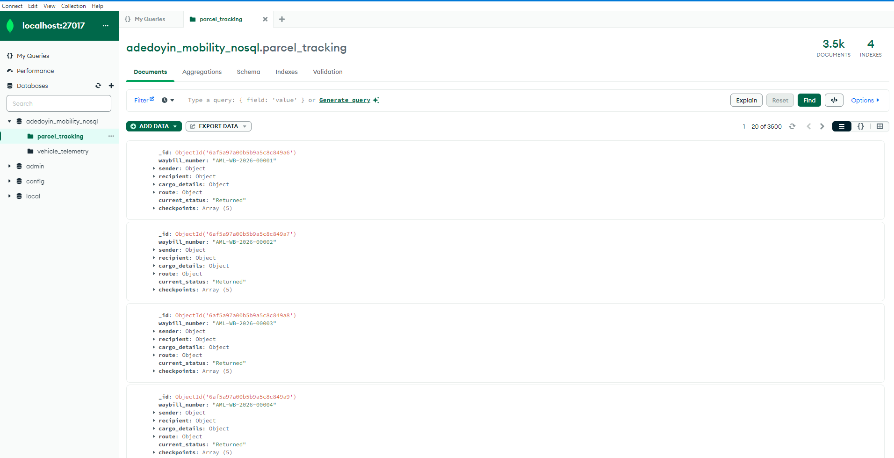
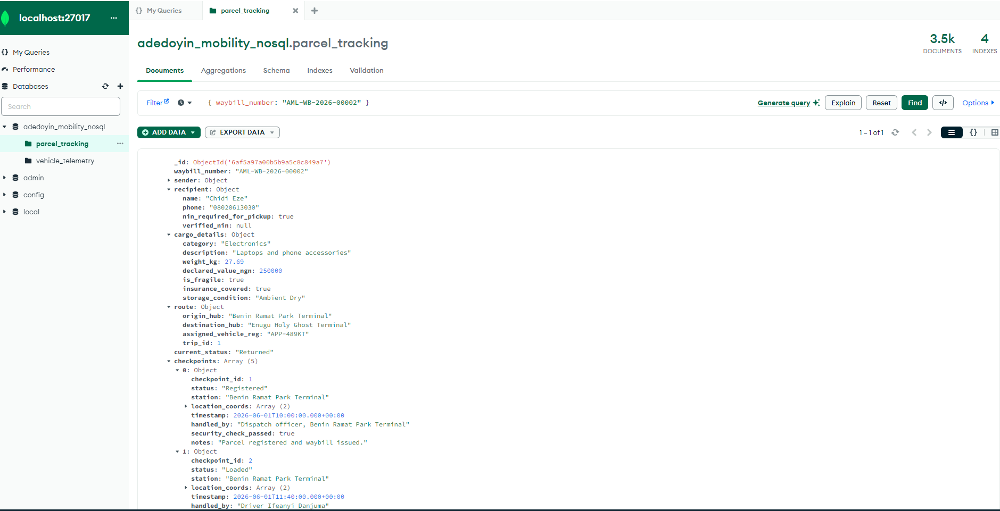
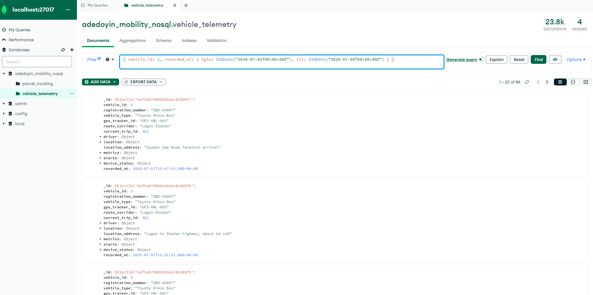

# Portfolio 4: NoSQL (Document Database)

Student Name: Adedoyin Ajeyomi
Student ID: 20260520
Course: MIT 8103 - Advanced Database Systems
Case Study: Adedoyin Mobility and Logistics
Database: MongoDB 9.0 (mongosh 2.14)

---

## 1. Why my company needs a NoSQL database

PostgreSQL is perfect for bookings, seats and money, because those need strict rules. But my company also produces two kinds of data that do not fit a table so well:

- GPS pings. Every vehicle sends its location, speed, fuel and engine temperature every 15 minutes during a trip. This is a steady stream of small records, and the fields can change when a new sensor is added.
- Parcel history. A parcel passes through a different number of checkpoints depending on what happens to it (registered, loaded, in transit, arrived, delivered or returned). In a table this would be many rows joined together. In a document database the whole history sits inside the parcel itself.

So I used MongoDB as a document database for these two things, and kept PostgreSQL for bookings. Using two databases for the jobs they do best is called polyglot persistence.

## 2. The data

The data is not typed by hand. A Python script, `data/Ajeyomi_Adedoyin_20260520_NoSQL_Data_Generator.py`, builds it from my SQL dataset, so both databases describe the same company:

- vehicle_telemetry: 23,802 pings. They come from the 897 completed trips in PostgreSQL, using the real vehicles, drivers and routes. A ping is made every 15 minutes along the road between the two stations.
- parcel_tracking: 3,500 parcels. These are the same 3,500 parcels as in PostgreSQL, with the same waybill numbers, senders and recipients. Each one has its checkpoints stored inside it.

Two links connect the databases. `vehicle_id` and `current_trip_id` in a ping match the vehicle and trip in PostgreSQL. `waybill_number` and `sender.customer_id` in a parcel match the parcel and customer in PostgreSQL.

A shortened ping from the real data looks like this:

    {
      vehicle_id: 1,
      registration_number: "APP-125KT",
      route_corridor: "Enugu-Benin",
      current_trip_id: 5,
      driver: { driver_id: 9, name: "Tunde Bakare" },
      location: { type: "Point", coordinates: [6.56474, 6.37956] },
      metrics: { speed_kmh: 93.3, fuel_level_percent: 72.4, odometer_km: 108762.0 },
      alerts: { speed_warning: false, harsh_braking: false },
      recorded_at: ISODate("2026-06-01T14:33:02.000Z")
    }

The full model with one real example of each collection is in `Ajeyomi_Adedoyin_20260520_NoSQL_Model.json`.

## 3. Rules in the collections (schema validation)

MongoDB does not force a schema, but I added validation so bad data is refused. For example, a ping must have a location, a speed between 0 and 200, and fuel between 0 and 100. A parcel must have a waybill number in the form AML-WB-2026-00001.

The validation caught a real mistake while I was building this. My data generator produced a fuel level of 101.3 for one ping, and MongoDB refused it. I fixed the generator so fuel never goes above 100. I also tested a parcel with the waybill number `BAD-123`. The real output shows:

    refused: Document failed validation

## 4. Indexes

I measured four queries first with no extra indexes, then created these indexes and measured again:

- A 2dsphere index on the ping location, to find vehicles near a place.
- An index on vehicle and time, to read one vehicle's history.
- An index on corridor and speeding alert, to find speeding on a route.
- A unique index on waybill number, to find a parcel straight away.
- Two more indexes on parcel checkpoints and on parcel route and status.

## 5. Results (real output from explain)

All numbers below come from `explain("executionStats")` on my own computer. The unedited output is in `Ajeyomi_Adedoyin_20260520_NoSQL_Execution_Results.txt`.

Q1, pings within 80 km of Abuja:
- Before: full scan of 23,802 documents, 30 ms.
- After: 2dsphere index scan, 2,762 documents examined, 8 ms. The query returns 2,428 pings.

Q2, one vehicle's pings in one week, newest first:
- Before: full scan plus a sort, 23,802 documents, 60 ms.
- After: index scan, 88 documents, 0 ms.

Q3, find a parcel by waybill number:
- Before: full scan of 3,500 documents, 5 ms.
- After: index lookup, 1 document, 0 ms.

Q4, speeding alerts on the Lagos-Abuja corridor:
- Before: full scan of 23,802 documents, 59 ms.
- After: index scan, 126 documents, 0 ms.

The times are whole milliseconds, because that is what explain reports, so small times show as 0 ms. The number of documents examined is the clearest proof: for example, Q2 went from 23,802 documents to 88.

## 6. The five queries

The script also runs five business queries. Their real results are in the results file.

1. Vehicles within 80 km of Abuja Utako, nearest first (geospatial `$nearSphere`).
2. The fastest speeding events above the 100 km/h limit.
3. The full audit trail of one parcel, waybill AML-WB-2026-00002, with all its checkpoints.
4. Parcel scans per station and status, using an aggregation pipeline (`$unwind`, `$group`, `$sort`).
5. A telemetry summary for each corridor: pings, average speed, top speed and speeding pings.

## 7. Auto-expiry of old data (TTL index)

Old GPS pings are not worth keeping forever, so MongoDB can delete them by itself with a TTL index. I did not put a TTL index on the real telemetry, because that data is from June to September 2026 and MongoDB would delete all of it at once. Instead I tested it on a small separate collection, where documents expire 30 seconds after `recorded_at`:

- I inserted 3 documents: two already old, and one that was not yet old enough to expire.
- Before waiting: 3 documents.
- After waiting 80 seconds: 1 document. Only the one that was not yet old enough was left.

In real use I would set the expiry to a longer time, for example 30 days.

## 8. What I learned

- A document database stores what is read together in one place. One read gives a parcel's whole history.
- Indexes matter just as much in MongoDB as in PostgreSQL. Without them, every query reads every document.
- A geospatial index lets one query find vehicles near a place.
- Validation rules keep a flexible database tidy.
- A document database is not a replacement for PostgreSQL here. Seats and money stay in PostgreSQL where they have strict rules.

## 9. Screenshots from MongoDB Compass

The parcel_tracking collection: 3,500 documents and 4 indexes (the default one plus my three).

One parcel found by its waybill number. The checkpoints are stored inside the parcel document, so one read gives the whole history.

The vehicle_telemetry collection (23,802 pings). One vehicle's pings for one week return 88 documents, the same number as in the results file.

## 10. How to run it again

1. Install MongoDB and mongosh, and make sure MongoDB is running on the normal port 27017.
2. Open PowerShell in the repository folder and run:

       mongosh --quiet --file portfolio-4-nosql\Ajeyomi_Adedoyin_20260520_MongoDB_Queries.js > portfolio-4-nosql\Ajeyomi_Adedoyin_20260520_NoSQL_Execution_Results.txt

   It takes about one and a half minutes, because the TTL test waits 80 seconds.
3. To make the data files again, run `python data\Ajeyomi_Adedoyin_20260520_NoSQL_Data_Generator.py`.
4. To look at the collections, open MongoDB Compass, connect to `mongodb://localhost:27017` and open the database `adedoyin_mobility_nosql`.

## 11. Files

- `Ajeyomi_Adedoyin_20260520_MongoDB_Queries.js`: the script (collections, loading, benchmarks, indexes, queries, TTL test).
- `Ajeyomi_Adedoyin_20260520_NoSQL_Execution_Results.txt`: the real output.
- `Ajeyomi_Adedoyin_20260520_NoSQL_Model.json`: the model with one example document of each collection.
- `../data/vehicle_telemetry.json` and `../data/parcel_tracking.json`: the generated data.
- `assets/Ajeyomi_Adedoyin_20260520_NoSQL_Document_Architecture.png`: the diagram.
