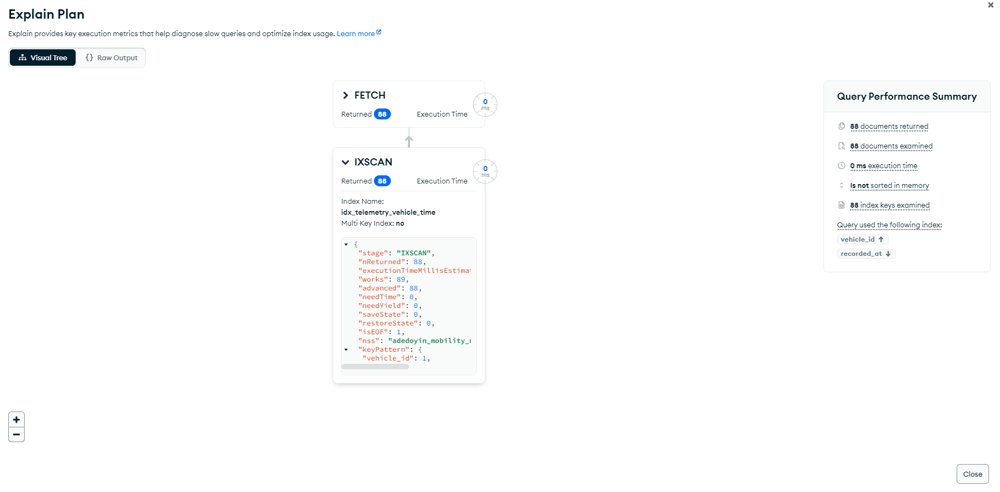
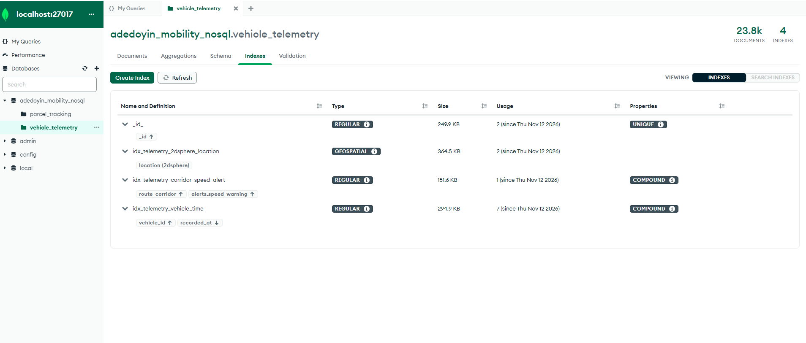

# Portfolio 4: NoSQL (Document Database)

Student Name: Adedoyin Ajeyomi
Student ID: 20260520
Course: MIT 8103 - Advanced Database Systems
Case Study: Adedoyin Mobility and Logistics
Database: MongoDB 9.0 (mongosh 2.14)

---

## 1. Why my company needs a NoSQL database

PostgreSQL is good for bookings, seats and money, because those need strict rules. But my company also has two kinds of data that do not fit a table so well:

- GPS locations. Every vehicle sends its location, speed, fuel and engine temperature every 15 minutes during a trip. This is a steady flow of small records, and new fields can be added when a new sensor is fitted.
- Parcel history. A parcel passes through a different number of checkpoints, depending on what happens to it (registered, loaded, on the road, arrived, delivered or returned). In a table, this needs many rows joined together. In a document database, the whole history sits inside the parcel itself.

So I used MongoDB, a document database, for these two things, and I kept PostgreSQL for bookings. Using two databases, each for the job it does best, is a normal and good way to build a system.

## 2. The data

The data is not typed by hand. A Python script, `data/Ajeyomi_Adedoyin_20260520_NoSQL_Data_Generator.py`, makes it from my SQL data, so both databases describe the same company:

- `vehicle_telemetry`: 23,802 GPS location records. They come from the 897 completed trips in PostgreSQL, using the real vehicles, drivers and routes. One record is made every 15 minutes along the road between the two stations.
- `parcel_tracking`: 3,500 parcels. These are the same 3,500 parcels as in PostgreSQL, with the same waybill numbers, senders and recipients. Each parcel has its checkpoints inside it.

Two keys connect the databases. In a GPS record, `vehicle_id` and `current_trip_id` match the vehicle and trip in PostgreSQL. In a parcel, `waybill_number` and `sender.customer_id` match the parcel and customer in PostgreSQL.

The field `route_corridor` holds the route the vehicle is on, for example `Lagos-Abuja`.

A shortened GPS record from the real data looks like this:

    {
      vehicle_id: 1,
      registration_number: "APP-125KT",
      route_corridor: "Enugu-Benin",
      current_trip_id: 5,
      driver: { driver_id: 9, name: "Tunde Bakare" },
      location: { type: "Point", coordinates: [7.18865, 6.4163] },
      metrics: { speed_kmh: 76.4, fuel_level_percent: 71.2, odometer_km: 98412.5 },
      alerts: { speed_warning: false, harsh_braking: false },
      recorded_at: ISODate("2026-06-01T14:33:02.000Z")
    }

The full model, with one real example of each collection, is in `Ajeyomi_Adedoyin_20260520_NoSQL_Model.json`.

## 3. Rules for the data (validation)

MongoDB does not force a fixed structure, but I added rules so that bad data is refused. For example, a GPS record must have a location, a speed between 0 and 200, and a fuel level between 0 and 100. A parcel must have a waybill number like AML-WB-2026-00001.

These rules caught a real mistake while I was building this. My data script made a fuel level of 101.3 for one record, and MongoDB refused it. I fixed the script so fuel never goes above 100. I also tested a parcel with the waybill number `BAD-123`. The real output shows:

    refused: Document failed validation

## 4. Indexes

I timed four queries first with no extra indexes, then I created these indexes and timed them again:

- A 2dsphere index on the location, to find vehicles near a place.
- An index on vehicle and time, to read the history of one vehicle.
- An index on route and speeding alert, to find speeding on a route.
- A unique index on the waybill number, to find a parcel straight away.
- Two more indexes, on parcel checkpoints and on parcel route and status.

## 5. Results (real output from explain)

All the numbers below come from `explain("executionStats")` on my own computer. The unedited output is in `Ajeyomi_Adedoyin_20260520_NoSQL_Execution_Results.txt`.

Q1, GPS locations within 80 km of Abuja:
- Before: a full scan of 23,802 documents, 30 ms.
- After: the 2dsphere index, 2,762 documents examined, 7 ms. The query returns 2,428 records.

Q2, the GPS locations of one vehicle for one week, newest first:
- Before: a full scan plus sorting, 23,802 documents, 61 ms.
- After: the index, 88 documents, 0 ms.

Q3, find a parcel by its waybill number:
- Before: a full scan of 3,500 documents, 6 ms.
- After: the index, 1 document, 0 ms.

Q4, speeding alerts on the Lagos-Abuja route:
- Before: a full scan of 23,802 documents, 48 ms.
- After: the index, 126 documents, 0 ms.

The times are whole milliseconds, because that is how explain reports them, so a very small time shows as 0 ms. The number of documents examined is the clearest proof. For example, Q2 went from 23,802 documents to 88.

## 6. The five queries

The script also runs five business queries. Their real results are in the results file.

1. Vehicles within 80 km of Abuja Utako, nearest first.
2. The fastest speeding events above the 100 km/h limit.
3. The full history of one parcel, waybill AML-WB-2026-00002, with all its checkpoints.
4. Parcel scans at each station, by status (a grouping query).
5. A summary for each route: number of records, average speed, top speed and number of speeding records.

## 7. Old data deleting itself (TTL index)

GPS records are not worth keeping forever, so MongoDB can delete old ones by itself with a TTL index. I did not put a TTL index on the real data, because it is from June to September 2026 and MongoDB would delete all of it at once. So I tested it on a small separate collection, where a document is deleted 30 seconds after `recorded_at`:

- I added 3 documents: two already old, and one that was not yet old enough to expire.
- Before waiting: 3 documents.
- After waiting 80 seconds: 1 document. Only the one that had not expired was left.

In real use I would set a longer time, for example 30 days.

## 8. What I learned

- A document database keeps together the things that are read together. One read gives the whole history of a parcel.
- Indexes matter in MongoDB just as in PostgreSQL. Without them, every query reads every document.
- A map index lets one query find vehicles near a place.
- Rules for the data keep a flexible database tidy.
- A document database does not replace PostgreSQL here. Seats and money stay in PostgreSQL, where the rules are strict.

## 9. Screenshots from MongoDB Compass

The `parcel_tracking` collection: 3,500 documents and 4 indexes (the default one and my three).

One parcel found by its waybill number. The checkpoints are inside the parcel, so one read gives the whole history.

The `vehicle_telemetry` collection (23,802 GPS location records). The GPS locations of one vehicle for one week give 88 documents, the same number as in the results file.

The explain plan for the same query in Compass. It uses the index (IXSCAN) on `idx_telemetry_vehicle_time`, reads only the 88 documents it returns, and takes 0 ms. Without the index, the script had to read all 23,802 documents.

The indexes on `vehicle_telemetry` in Compass: the default `_id_` index, the 2dsphere index on location, an index on route and speeding alert, and an index on vehicle and time.

## 10. How to run it again

1. Install MongoDB and mongosh, and make sure MongoDB is running on the normal port 27017.
2. Open PowerShell in the repository folder and run:

       mongosh --quiet --file portfolio-4-nosql\Ajeyomi_Adedoyin_20260520_MongoDB_Queries.js > portfolio-4-nosql\Ajeyomi_Adedoyin_20260520_NoSQL_Execution_Results.txt

   It takes about one and a half minutes, because the TTL test waits 80 seconds.
3. To make the data files again, run `python data\Ajeyomi_Adedoyin_20260520_NoSQL_Data_Generator.py`.
4. To look at the collections, open MongoDB Compass, connect to `mongodb://localhost:27017` and open the database `adedoyin_mobility_nosql`.

## 11. Files

- `Ajeyomi_Adedoyin_20260520_MongoDB_Queries.js`: the script (collections, loading, timing, indexes, queries and the TTL test).
- `Ajeyomi_Adedoyin_20260520_NoSQL_Execution_Results.txt`: the real output.
- `Ajeyomi_Adedoyin_20260520_NoSQL_Model.json`: the model, with one example document of each collection.
- `../data/vehicle_telemetry.json` and `../data/parcel_tracking.json`: the generated data.
- `assets/Ajeyomi_Adedoyin_20260520_NoSQL_Document_Architecture.png`: the diagram.
