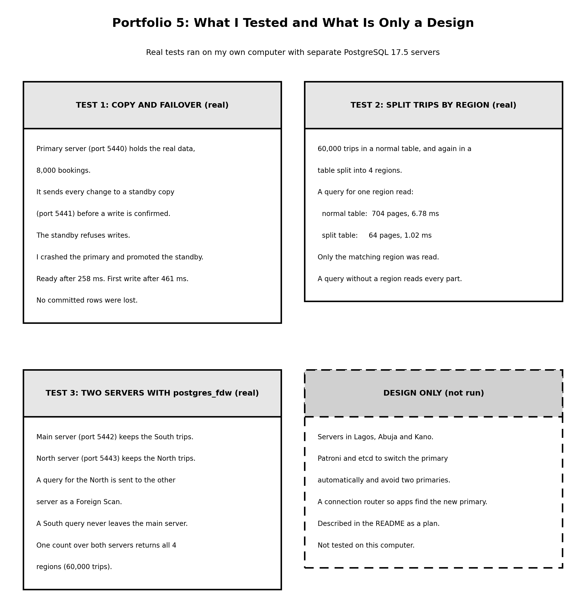
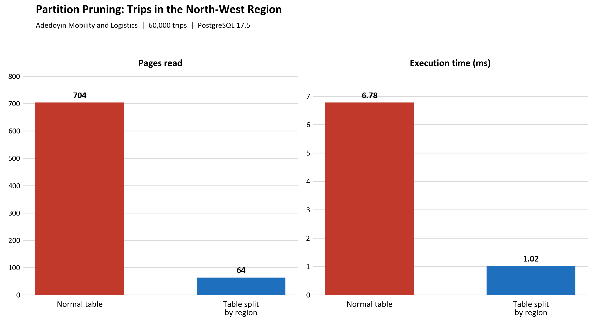

# Portfolio 5: Distributed and Cloud Databases

Student Name: Adedoyin Ajeyomi
Student ID: 20260520
Course: MIT 8103 - Advanced Database Systems
Case Study: Adedoyin Mobility and Logistics
Database: PostgreSQL 17.5

---

## 1. What this portfolio is about

My company works in six cities, so one database server is a risk. If it fails, nobody can book a seat. If it gets too busy, everyone waits. A distributed database solves this with three ideas:

- Replication: a second server keeps a live copy of the data.
- Failover: if the main server fails, the copy takes over.
- Sharding: a big table is split into parts, for example by region, so each query reads less.

I did not use a real cloud service such as AWS or Azure, because that needs paid servers in several cities. Instead I ran separate PostgreSQL servers side by side on my own computer, each in its own folder and on its own port. They behave like separate machines. The real cloud setup is described in section 6 as a plan, and I say clearly that I did not run it.

## 2. How I tested

Two PowerShell scripts build the test servers, run the tests and save the real output. They use a temporary folder and ports 5440 to 5443, so my main database is never touched. They need no password.

- `Ajeyomi_Adedoyin_20260520_Run_Replication_Failover_Test.ps1` writes `Ajeyomi_Adedoyin_20260520_Replication_Failover_Test_Results.txt`.
- `Ajeyomi_Adedoyin_20260520_Run_Sharding_Test.ps1` writes `Ajeyomi_Adedoyin_20260520_Sharding_Test_Results.txt`.

Nothing in the results files was typed by hand.

## 3. Test 1: copy and failover

I started a primary server and made a standby copy of it from my real data (8,000 bookings). I switched on synchronous replication. This means the primary only confirms a write after the standby has it too.

- On the primary, the link shows `aml_standby | streaming | sync`. The standby is connected and in step.
- The standby had the same 8,000 bookings and the same 1,000 test rows as the primary.
- A write on the standby is refused: `ERROR: cannot execute INSERT in a read-only transaction`. The copy is read only until it is promoted.

Then I crashed the primary on purpose (an immediate stop, with no clean shutdown) and promoted the standby:

- The standby was ready as the new primary 258 ms after the crash.
- The first successful write on the new primary came 461 ms after the crash.
- All 1,000 rows written before the crash were still there, plus the new one. No committed data was lost.

This is the real value of synchronous replication: safety. The cost is that every write has to wait for the copy. If the standby is down, writes wait as well. A company has to choose between safety and speed.

## 4. Test 2: split the trips table by region

I made a table of 60,000 trips and added a region to each trip (South-West, North-Central, North-West and South-East-South). I made two versions: a normal table, and a table split into four parts, one per region. Then I ran the same query on both: all completed trips that start in the North-West.

- Normal table: it read the whole table, 704 pages, in 6.78 ms.
- Split table: it read only the North-West part, 64 pages, in 1.02 ms.

This is called partition pruning. PostgreSQL sees the region in the query and skips the other parts.

Pruning only works when the query names the region. A query that does not (for example, all cancelled trips) has to read every part (703 pages), so the split gives no gain there. The region is a good split key for my company because most dispatch work is for one region at a time.

## 5. Test 3: two servers with postgres_fdw

Splitting by region also lets the parts live on different servers. I started two servers. The main server (port 5442) keeps the South trips. A second server (port 5443) keeps the North trips. On the main server I made one trips table with two parts: the South part is local and the North part is a foreign table, linked to the second server with `postgres_fdw`.

- A query for the North is sent to the other server. The plan shows a `Foreign Scan` with the remote query that was sent.
- A query for the South stays on the main server and never touches the second one.
- One count over the whole table returned all four regions, 60,000 trips: 23,700 South-West, 19,450 South-East-South, 11,250 North-Central and 5,600 North-West. Some of those rows were read from the other server.

## 6. The real cloud setup (a plan, not run)

This part is a design. I did not run it.

- Servers: a primary in Lagos, with standby copies in Abuja and Kano. Each region could also have its own shard.
- Automatic failover: Test 1 switched the servers by hand. In a real system, a tool such as Patroni with etcd watches the primary and promotes a standby by itself. It also makes sure two servers never think they are the primary at the same time (split brain). Detecting a failure takes some seconds, so a real failover would be slower than the 461 ms I measured.
- Routing: apps connect through a router or virtual address that always points to the current primary.
- Backups: copies protect against a server failing, but they copy mistakes too. So regular backups are still needed.
- Passwords: a real setup uses strong passwords and encrypted connections. My test servers use no password because they only exist on my own computer for a few minutes.

## 7. What I learned

- A standby copy gives safety, and failover keeps the company working. A synchronous copy never loses committed data, but writes wait for it.
- Splitting a big table by region makes queries read much less, as long as the query uses the region.
- One query can read from more than one server with postgres_fdw, and PostgreSQL sends it only to the servers that are needed.
- The cloud part needs more tools and more care than my tests, mainly to detect failures and avoid two primaries.
- Real tests teach more than a description. When I measured the failover and the pruning myself, I got numbers I can explain.

## 8. How to run it again

Open PowerShell in the repository folder and run:

    Set-ExecutionPolicy -Scope Process -ExecutionPolicy Bypass
    .\portfolio-5-distributed-cloud\Ajeyomi_Adedoyin_20260520_Run_Replication_Failover_Test.ps1
    .\portfolio-5-distributed-cloud\Ajeyomi_Adedoyin_20260520_Run_Sharding_Test.ps1

The first takes about three minutes and the second about one minute. Add `-KeepRunning` to the first one if you want to open the new primary in pgAdmin 4 (host localhost, port 5441, user postgres, no password).

## 9. Files in this folder

- `Ajeyomi_Adedoyin_20260520_Run_Replication_Failover_Test.ps1` and its results file.
- `Ajeyomi_Adedoyin_20260520_Run_Sharding_Test.ps1` and its results file.
- `assets/Ajeyomi_Adedoyin_20260520_Distributed_Cluster_Topology.png`: the overview diagram.
- `assets/Ajeyomi_Adedoyin_20260520_Partition_Pruning_Benchmark.png`: the pruning chart.
